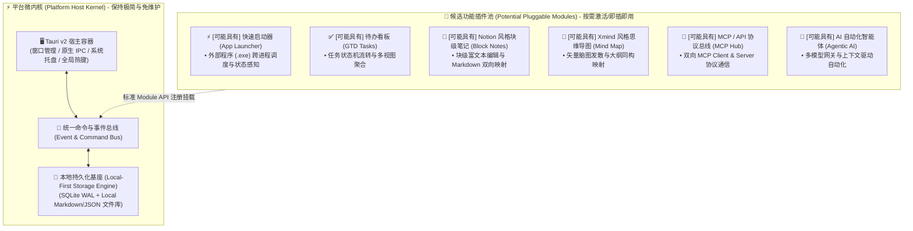

# SelfWork 个人工作台：系统架构与候选能力全景 (Architecture & Potential Capabilities)

> **版本定位**：v0.1.0-draft (架构确认与候选能力全景规划)  
> **核心原则**：**微内核 + 可插拔候选模块 (Micro-Kernel with Pluggable Potential Modules)**。  
> **特别声明**：本文档所规划的高级业务功能（思维导图、笔记、启动器、待办、MCP、AI 等）均为**可能具备的候选功能 (Potential Features)**。本阶段仅完成架构契约与边界界定，严禁在未获明确指令前提前堆砌业务代码。

---

## 🏛️ 一、 微内核物理架构 (Micro-Kernel Architecture)

系统由**极简稳定的平台宿主内核 (Stable Host Kernel)** 与 **相互隔离的候选能力池 (Potential Capability Pool)** 构成：

---

## 🎯 二、 候选功能矩阵与边界契约 (Potential Features Matrix & Contracts)

每个模块在未开发时仅作为**类型契约与接口占位**存在，互不耦合。未来若决定开发，将按照以下独立规范平滑接入：

### 1. [可能具有] 快速启动器模块 (App Quick Launcher)
- **定位**：解决日常工程中频繁寻找不同程序快捷方式的痛点，提供低延迟呼出面板。
- **核心契约**：
  - 输入：程序路径 (`filePath`)、运行参数 (`args`)、环境变量与自定义标签；
  - 操作系统层：由 Tauri Rust 后端直接调用跨平台 `std::process::Command`，隔离命令注入隐患；
  - 状态反馈：返回进程 ID (PID) 或启动失败的显式错误枚举（`FileNotFound | PermissionDenied | ProcessCrashed`）。

### 2. [可能具有] 待办看板模块 (GTD & Tasks)
- **定位**：个人日常任务沉淀与推进看板。
- **核心契约**：
  - 状态机显式约束：`Todo ➔ InProgress ➔ Blocked ➔ Done | Cancelled`；
  - 任务项解耦：每个任务作为独立原子实体，支持打标签、设置截止日期与优先级；
  - 聚合能力：未来可作为插件被笔记或思维导图挂载引用，但其核心引擎不依赖任何具体编辑器。

### 3. [可能具有] Notion 风格块级笔记 (Block-Based Notes)
- **定位**：结构化深度知识沉淀、研发备忘与工作日志。
- **核心契约**：
  - 块级状态机：每个内容片段为独立 Block（`Paragraph | Heading | TodoItem | CodeBlock | Table`）；
  - 本地优先：文档直接以干净的 Markdown 文件存储，前置 YAML 元数据用于记录块关系；
  - 双向同步：数据改动自动落盘，支持 Git 原生追踪。

### 4. [可能具有] Xmind 风格思维导图 (Mind Map)
- **定位**：发散性思考、方案规划与架构脑暴。
- **核心契约**：
  - 拓扑模型：有向树形结构（`Node: id, parentId, childrenIds, text, style, folded`）；
  - 渲染解耦：布局引擎（计算坐标与曲线路径）与视图渲染层（Canvas/SVG）严格分离；
  - 同构转换接口：预留“脑图节点列表 ⟷ Markdown 大纲”的无损转换算法接口。

### 5. [可能具有] MCP / API 协议总线 (Model Context Protocol Hub)
- **定位**：连接外部生态能力，并使工作台具备被外部大模型调度的能力。
- **核心契约**：
  - 角色 A (MCP Client)：支持加载本地已有的 MCP Server（如文件系统、数据库、合规检测等）；
  - 角色 B (MCP Server)：向外部暴露工作台内部数据为只读 Resource 或受控 Tool；
  - 通信协议：严格遵循 JSON-RPC 2.0 (stdio / SSE)。

### 6. [可能具有] AI 大模型 API 与自动化行为 (Agentic AI Engine)
- **定位**：工作台内置的 AI 助手与自动化操作员。
- **核心契约**：
  - 统一网关：抽象 `ChatCompletion` 接口，支持 OpenAI 标准、Gemini、Claude、DeepSeek 与本地 Ollama；
  - 上下文管道：以只读方式安全提取当前活跃模块的文本片段并注入 Prompt；
  - 工具调用调度：模型返回的 Tool Call 请求必须经由系统总线派发，用户拥有显式批准或拦截权。

---

## 🔒 三、 架构不变量与防污染守则 (Invariants & Anti-Pollution Rules)

1. **零强耦合公理**：禁用任意两个候选功能模块之间的直接代码引用（如 `import { Note } from '../notes'` 出现在 `mindmap` 中属于非法违规）；若需联动，必须通过内核 `EventBus` 发送弱耦合事件；
2. **纯净存储公理**：每个模块在存储层拥有独立的数据命名空间（如 `workspace-data/notes/`、`workspace-data/mindmaps/`），互不穿透；
3. **按需演进公理**：在用户给出明确开发指令前，上述候选模块仅停留在架构规划层面，保持代码库极简。
