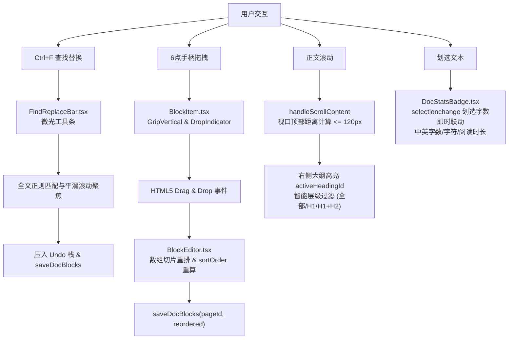

# 技术设计：阶段 3 写作交互与生产力增强

## 1. 架构拓扑与交互模型

## 2. 状态设计与因果隔离
1. **HTML5 原生拖拽**：
   - 抓手容器 `draggable={true}`，不干扰内部 contenteditable 或输入组件的文字选区行为；
   - 拖拽源携带 `e.dataTransfer.setData('text/plain', block.id)`；
   - 目标容器监听 `onDragOver` 计算 `clientY - rect.top < rect.height / 2` 决定 `top` 或 `bottom` 指示线；
   - `onDrop` 回调触发主数组切片插入并批量重排 `sortOrder`。
2. **ScrollSpy 滚动计算**：
   - `scrollContainerRef.current` 容器监听 `onScroll`；
   - 获取各标题 `rect.top - containerTop <= 120`，锁定当前阅读位置并无损高亮大纲。
3. **统计胶囊响应机制**：
   - 全局字数基于 `blocks` 依赖 `useMemo` 计算；
   - 选区字数基于 `document.addEventListener('selectionchange', ...)` 监听，划选即现，取消选区即退回全局统计。
