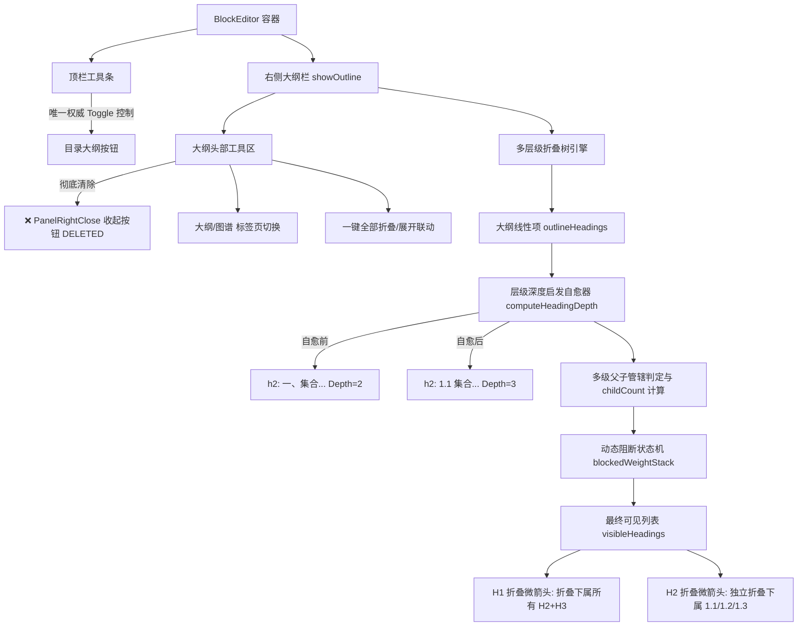

# 技术架构设计与状态机 (Design)

## 1. 架构因果拓扑



## 2. 深度自愈与多层级折叠算法

### 2.1 层级深度计算函数
```typescript
function getHeadingDepth(type: string, text: string): number {
  const clean = text.trim();
  // 1. 若本身是 h1
  if (type === 'h1') return 1;
  // 2. 若本身是 h2，但以点分数字编号开头 (如 1.1, 1.2, 2.1.3 等)
  if (type === 'h2' && /^\d+\.\d+/.test(clean)) return 3;
  // 3. 常规 h2
  if (type === 'h2') return 2;
  // 4. h3 若含三级点分编号 (如 1.1.1) 可升至 4，否则为 3
  if (type === 'h3') {
    return /^\d+\.\d+\.\d+/.test(clean) ? 4 : 3;
  }
  return 3;
}
```

### 2.2 父子管辖与下属条数计算
对于第 $i$ 项，其深度为 $D_i$：
从 $j = i + 1$ 往后扫描：
- 若 $D_j \le D_i$，则停止（遇到同级或更高级）；
- 若 $D_j > D_i$，则该项属于其下属节点，`childCount++`；
若扫描到的直接下一项 $D_{i+1} > D_i$，则 `hasChildren = true`。

### 2.3 多层级折叠可见性状态机
遍历所有项时，维护一个活跃折叠父节点栈或最小阻断深度 $D_{\text{block}}$：
- 若遇到当前深度 $\le D_{\text{block}}$，则解除该折叠阻断；
- 若处于阻断深度之下，则该项被隐藏；
- 若未被阻断且该项处于 `collapsedHeadingIds` 中，则将阻断深度设置为该项的深度 $D_i$。

这样，点击 H1 折叠时阻断深度为 1，隐藏所有 H2 和 H3；
点击 H2 折叠时阻断深度为 2，精准隐藏该 H2 下属的所有深度为 3 的小节，同级其他 H2 及其子项完好无损！
