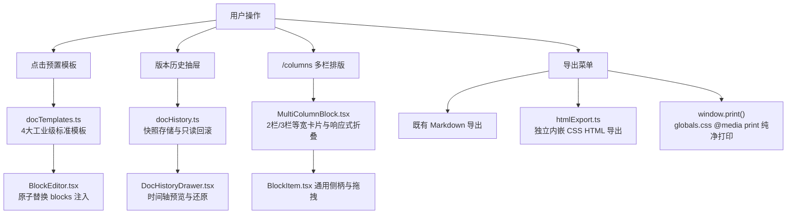

# 技术设计：阶段 4 块级流转、模板库与历史版本

## 1. 架构拓扑与交互模型



## 2. 数据模型设计

### 2.1 多栏块数据结构
```ts
export interface ColumnsBlockProperties {
  columnCount: 2 | 3;
  columns: Array<{
    id: string;
    content: string;
  }>;
}
```

### 2.2 快照数据结构
```ts
export interface DocSnapshot {
  id: string;
  pageId: string;
  timestamp: number;
  label?: string;
  blockCount: number;
  wordCount: number;
  charCount: number;
  blocks: DocBlock[];
}
```

## 3. 打印与 PDF 导出设计
在 `src/styles/globals.css` 中注入：
```css
@media print {
  /* 隐藏所有界面导航与编辑器辅助控件 */
  .no-print,
  aside,
  header,
  nav,
  .doc-titlebar,
  .outline-panel,
  .doc-stats-badge,
  .find-replace-bar,
  .group:hover .opacity-100,
  button {
    display: none !important;
  }

  body, html, #root {
    background: #ffffff !important;
    color: #111827 !important;
    overflow: visible !important;
    height: auto !important;
  }

  .doc-typography {
    max-width: 100% !important;
    padding: 0 !important;
    margin: 0 !important;
  }
}
```
保证在打印对话框（选择“另存为 PDF”）时，排版极其整洁、典雅，达到出版级文档标准。
