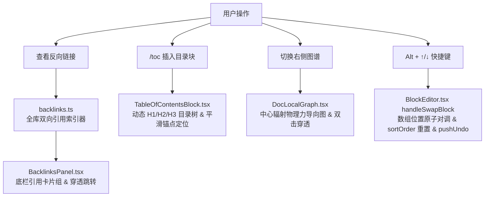

# 技术设计：阶段五（维度 1）知识网络与双向拓扑闭环

## 1. 架构拓扑与交互模型



## 2. 反向链接数据模型与扫描算法
```ts
export interface BacklinkItem {
  sourcePageId: string;
  sourcePageTitle: string;
  sourcePageIcon?: string;
  sourceUpdatedAt: number;
  blockId: string;
  contextPreview: string;
}
```
扫描准则：
- 遍历所有 `pages.filter(p => p.id !== currentPageId)`；
- 读取各页面 `blocks`，检索包含 `#/page/${currentPageId}` 或 `data-page-link` 的块；
- 剥离 HTML 标签，截取关键词前后约 40 个字符作为上下文预览；
- 结果按引用页面更新时间倒序排序。

## 3. 局部图谱力导向物理模型
采用纯轻量 SVG + 弹簧动力学方程：
- 节点库：中心节点 $N_{center}$ 与周边卫星节点 $N_1, N_2, \dots, N_k$；
- 库伦斥力：$F_{rep} = \frac{k_r}{d^2}$（节点间相互排斥，防止重叠堆积）；
- 胡克引力：$F_{spring} = -k_s (d - d_0)$（相连边保持弹性拉扯）；
- 阻尼衰减：$v = v \times 0.85$，经过 60 帧自动平稳收敛；
- 零外部依赖，极速 60fps 原生流畅渲染。
