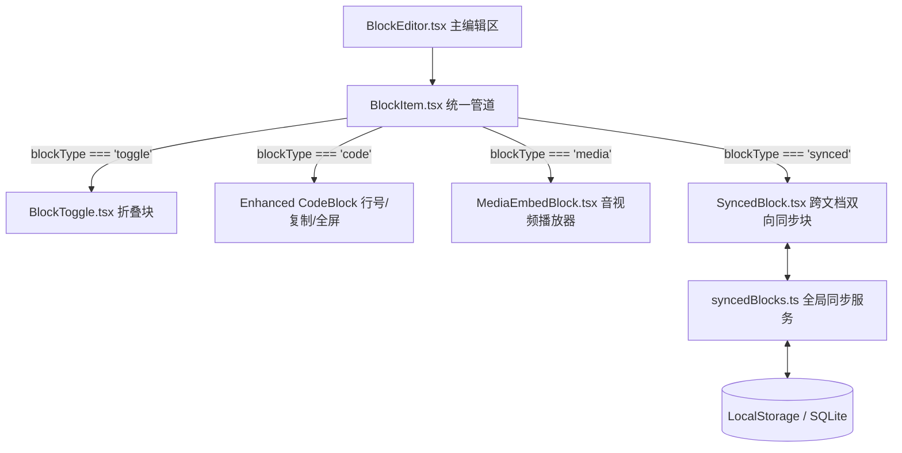

# 架构与设计方案 (Technical Design)

## 1. 架构总览与组件拓扑

## 2. 核心模块详细设计

### 2.1 折叠块标准管道收拢 (`BlockToggle.tsx` -> `BlockItem.tsx`)
- 原先 `BlockEditor.tsx` 在第 963 行对 `toggle` 进行了单独特判并脱离了 `BlockItem`，导致其缺失了 6 点手柄、拖拽重排指示线与 `Alt + ↑/↓` 换块功能；
- 改造方案：统一在 `BlockItem.tsx` 内部挂载 `BlockToggle`，完全继承外层 `renderSideHandle`、`renderDropIndicator`、键盘流监听与快捷键！

### 2.2 代码块增强架构 (`BlockItem.tsx` -> CodeBlock 升级)
- 提取代码行数 `lines = content.split('\n')`；
- 左侧增加独立行号竖栏（`w-8 text-right pr-2 text-slate-600 font-mono text-xs select-none border-r border-white/5`）；
- 右上角胶囊悬浮栏增加：
  - 语言下拉选择（TypeScript, JavaScript, Rust, Python, Go, SQL, HTML, CSS, Bash, JSON, Markdown）
  - 行号开关切换（`properties.showLineNumbers`）
  - 一键复制代码（`navigator.clipboard.writeText` + 1.5s 绿色 Check 动画）
  - 全屏沉浸阅读浮窗（固定遮罩 + 居中大视口编辑器）

### 2.3 音视频多媒体块 (`MediaEmbedBlock.tsx`)
- 自动探测输入链接后缀（`.mp4`, `.webm` -> 视频模式；`.mp3`, `.wav`, `.ogg` -> 音频模式；通用外链 -> iframe 嵌入模式）；
- 音频卡片提供紧凑暗黑进度条、播放/暂停开关与当前播放时长；
- 视频卡片自适应 16:9 比例与圆角毛玻璃微光边框。

### 2.4 跨文档双向同步块 (`SyncedBlock.tsx` & `syncedBlocks.ts`)
- 抽象服务 `src/services/syncedBlocks.ts`：
  - `getSyncedBlock(syncId: string): SyncedBlockData | null`
  - `saveSyncedBlock(syncId: string, content: string, title?: string): void`
  - `listAllSyncedBlocks(): SyncedBlockSummary[]`
- 同步块组件 `SyncedBlock.tsx`：
  - 呈现青色晶体边框（`border-teal-500/30 bg-teal-500/[0.02]`）；
  - 标题栏呈现「🔗 同步块 (Synced Block)」与 `syncId` 简写徽标；
  - 内部 contenteditable 实时修改内容，触发 `saveSyncedBlock` 持久化；
  - 提供快捷复制 `Sync ID` 按钮，便于在其他页面一键引用。

---

## 3. 法定双清单 (Dual-Manifest Verification)

### 3.1 拟变范围清单 (Proposed Scope)
| 文件路径 | 变更类型 | 因果角色与理由 |
|---|---|---|
| `src/types/docs.ts` | 修改 | [Root Source] 扩展 `BlockType` 增补 `'media' \| 'synced'` |
| `src/components/docs/editor/BlockToggle.tsx` | 重构优化 | [Component] 优化折叠状态与键盘流交互 |
| `src/components/docs/editor/BlockItem.tsx` | 修改 | [UI Entry] 统一收拢 `toggle` 分支并深度增强 `code` 代码块（行号/复制/全屏） |
| `src/components/docs/editor/BlockEditor.tsx` | 修改 | [Container] 移除 toggle 独立特判，统合入 BlockItem 统一渲染 |
| `src/components/docs/editor/SlashMenu.tsx` | 修改 | [UI Entry] 增补 `/toggle`, `/media`, `/synced` 快捷指令项 |
| `src/components/docs/editor/MediaEmbedBlock.tsx` | 新增 | [Component] 实现 REQ-D2.3 音视频卡片 |
| `src/components/docs/editor/SyncedBlock.tsx` | 新增 | [Component] 实现 REQ-D2.4 跨文档同步引用块 |
| `src/services/syncedBlocks.ts` | 新增 | [Service] 跨文档同步块底层持久化与检索服务 |
| `CHANGELOG.md` | 修改 | [Knowledge Base] 记录 `v0.1.63` 演进条目 |

### 3.2 保持现状承诺清单 (Preserve-As-Is Invariants)
- [x] **现有 16 种块类型与数据结构保持 100% 兼容**；
- [x] **打字机垂直留白与 Heading 节奏保持现状**；
- [x] **维度 1 的反向链接底栏、动态目录大纲块与力导向关系图谱保持 100% 完整**；
- [x] **Rust 后端 14 项单元测试底座保持绝对只读与 100% 全绿**。
