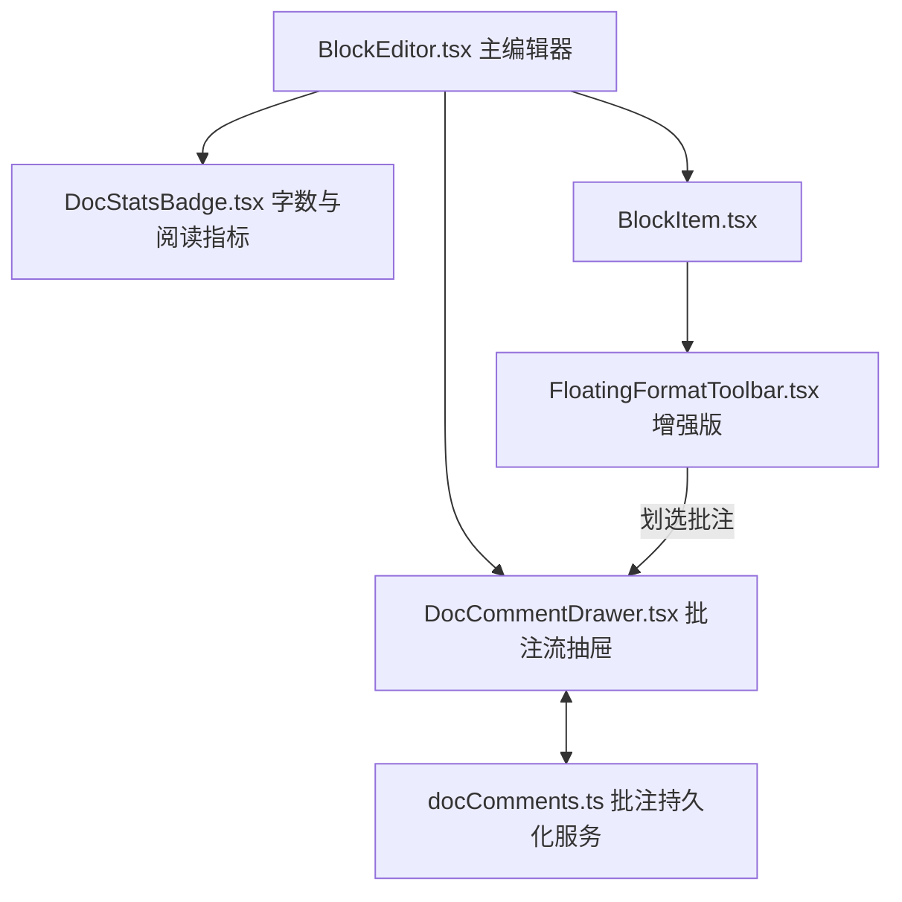

# 架构与设计方案 (Technical Design)

## 1. 架构总览

## 2. 核心模块与实现细节

### 2.1 行内划词批注系统 (`DocCommentDrawer.tsx` & `docComments.ts`)
- `docComments.ts`：提供 `getCommentsForPage(pageId)`、`addComment(...)`、`toggleResolveComment(id)`、`addCommentReply(...)`、`deleteComment(id)`；
- `DocCommentDrawer.tsx`：采用暗黑毛玻璃抽屉，右侧固定滑出，带有 Tab 过滤（未解决 / 已解决）；
- 在 `BlockItem.tsx` 划选文字时，浮动工具栏支持触发 `onAddComment(selectedText)`；
- 选中文本自动应用微光底纹与 `data-comment-id` 标记。

### 2.2 浮动工具栏全面补全 (`FloatingFormatToolbar.tsx`)
- 扩展 `HIGHLIGHT_COLORS` 为 5 款柔和微光色（黄/绿/蓝/紫/粉）；
- 增加行内代码 `<code>` 快速包裹；
- 增加一键清空内联样式 `document.execCommand('removeFormat')`；
- 工具栏末端增设「💬 批注」按钮。

### 2.3 全局折叠块展开/收起控制
- 在 `BlockEditor.tsx` 中统计当前 `blocks` 中 `blockType === 'toggle'` 的数量；
- 若数量 $> 0$，在顶栏或目录大纲顶部挂载折叠胶囊 `[▼ 展开全部] [▶ 收起全部]`；
- 实现 `handleFoldAll(isOpen: boolean)`：批量更新并保存。

### 2.4 阅读指标透视分析卡片 (`DocReadingTimeModal.tsx`)
- 升级 `DocStatsBadge.tsx`：点击统计胶囊时展开全景透视卡片；
- 显示环形或条形指示器：中文字数、英文字数、代码行数、多媒体块数；
- 双阅读时长展示：默读 (350 wpm) 与 演讲朗读 (180 wpm)。

---

## 3. 法定双清单 (Dual-Manifest Verification)

### 3.1 拟变范围清单 (Proposed Scope)
| 文件路径 | 变更类型 | 因果角色与理由 |
|---|---|---|
| `src/types/docs.ts` | 修改 | [Root Source] 增加批注与阅读指标数据接口 |
| `src/services/docComments.ts` | 新增 | [Service] 文档行内批注持久化服务 |
| `src/components/docs/editor/DocCommentDrawer.tsx` | 新增 | [Component] 批注侧滑抽屉与交互列表 |
| `src/components/docs/editor/FloatingFormatToolbar.tsx` | 修改 | [UI Entry] 增加批注按钮、5色微光荧光调色板、行内代码与清除格式 |
| `src/components/docs/editor/BlockItem.tsx` | 修改 | [Pipeline] 支持浮动工具栏批注事件回传 |
| `src/components/docs/editor/BlockEditor.tsx` | 修改 | [Container] 挂载批注抽屉、顶栏批注入口与全局折叠展开控制 |
| `src/components/docs/editor/DocStatsBadge.tsx` | 修改 | [Component] 点击展开全景细粒度阅读指标透视卡片 |
| `CHANGELOG.md` | 修改 | [Knowledge Base] 记录 `v0.1.64` 演进条目 |

### 3.2 保持现状承诺清单 (Preserve-As-Is Invariants)
- [x] **维度 1（反向链接、TOC 目录卡片、力导向图谱、Alt+↑/↓ 换块）保持 100% 完整**；
- [x] **维度 2（多级折叠列表、代码块行号/复制/全屏、音视频卡片、同步块）保持 100% 完整**；
- [x] **正文打字机留白与 Heading 节奏保持 100% 现状**；
- [x] **Rust 后端 14 项单元测试保持只读与 100% 全绿**。
