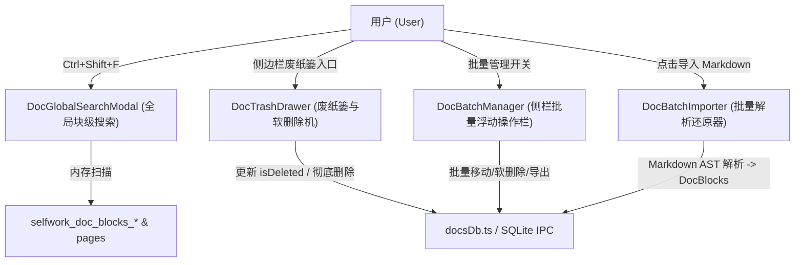
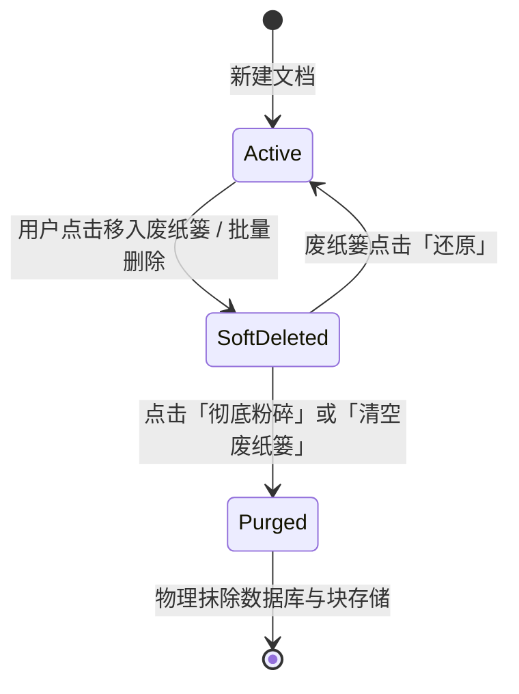

# 设计方案: 阶段五（维度 4）数据工程与全库深度管理

## 1. 架构与依赖拓扑



## 2. 状态机与因果设计

### 2.1 软删除与生命周期状态机


### 2.2 全局搜索过滤设计
- 扫描本地 `selfwork_doc_pages` 获取非软删除页面列表；
- 遍历加载所有非删除页面的 `selfwork_doc_blocks_${pageId}`；
- 正则与模糊分词匹配 `block.content` 与代码/公式内容；
- 按块类型过滤：`all` / `p` / `code` / `table` / `todo` / `headings`；
- 计算高亮片段与分数，提供 60fps 键盘即时交互。

### 2.3 Markdown 解析器流水线
- 按行扫描输入文本；
- 状态机识别代码块围栏（` ``` ` 跨行缓冲）；
- 状态机识别表格行（`|` 跨行缓冲并解析为 `TableBlockProperties.rows`）；
- 识别标题、待办、引用与段落；
- 组装为标准 `DocBlock[]` 数组并原子入库。
