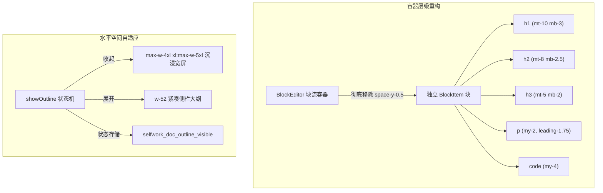

# 设计方案: 文档排版呼吸感与空间挤压优化

## 1. 架构方案与排版韵律模型

## 2. 状态机与因果设计

### 2.1 目录大纲栏显示状态机
- 用户首次进入：默认读取 `localStorage.getItem('selfwork_doc_outline_visible')`，若未设置且视口宽度 $< 1366px$ 则默认收起，宽屏下默认展开；
- 用户点击收起：记录 `false`，界面右侧平滑收拢，右侧顶角呈现极简大纲快捷胶囊；
- 用户点击展开：记录 `true`，大纲以 `w-52` 平滑展开。

### 2.2 垂直排版韵律 (Typographic Vertical Rhythm)
- 消除 `space-y-0.5` 带来的 CSS 选择器特异性劫持；
- 每个 `BlockItem` 外层包裹容器由其 `blockType` 动态分发正确的 margin classes；
- 标题自成群组：通过“大上方外边距 + 紧凑下方外边距”天然形成视觉邻近性（Gestalt Proximity），让读者清晰感知标题属于下方内容。
