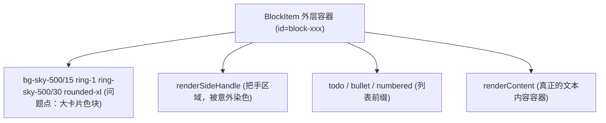
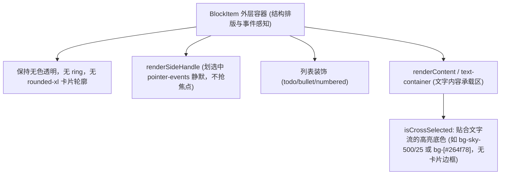

# 技术架构与设计方案：Word 级自然选区与段落块辅助化 (Design)

## 一、 问题根因剖析与架构解耦

### 1.1 现状缺陷拓扑
在之前的设计中，`isCrossSelected` 布尔值直接绑定在外层宿主 `div#block-${id}` 上：

这导致选区变成了“卡片级选中”，给用户极大的“被段落块物理束缚”的生硬感。

### 1.2 重构后的自然选区拓扑
将卡片式外壳剥离，将高亮样式精准下沉至文本内容承载区，段落块回归无形容器：


---

## 二、 核心技术方案细节

### 2.1 样式重构 (`BlockItem.tsx`)
1. **外层容器净化**：
   从 `id={block-${block.id}}` 容器中移除：
   `- isCrossSelected ? 'bg-sky-500/15 ring-1 ring-sky-500/30 rounded-xl transition-colors duration-75' : ''`
   外层容器仅保留基础结构定位与间距类名。
2. **文本内容区自然着色**：
   在 `renderContent()` 的文本编辑承载容器上，或在包裹文本编辑区的外围：
   当 `isCrossSelected` 时，赋予 `bg-sky-500/25 text-slate-100 rounded-none`（或贴合行高的微内边距背景），使得选中的是文字内容流，而非大块矩形卡片！
3. **划选状态下悬浮手柄穿透**：
   在拖拽划选进行时（`isMouseDownRef.current === true` 或 `crossSelectedBlockIds.size > 0`），侧边手柄 `renderSideHandle` 设置为 `pointer-events-none`，杜绝鼠标在拖拽快速掠过手柄时产生干扰。

### 2.2 全局文字选区协调一致性 (`index.css` / `BlockEditor.tsx`)
为正文编辑容器定义统一的 CSS 选区配色：
```css
.doc-editor-container ::selection {
  background-color: rgba(14, 165, 233, 0.35); /* sky-500 半透明 */
  color: #ffffff;
}
```
使单块内部的文字划选与跨块被选中的文本区域在视觉色调与透明度上 100% 毫无割裂感，彻底还原 Office Word 般一气呵成的整体质感。
