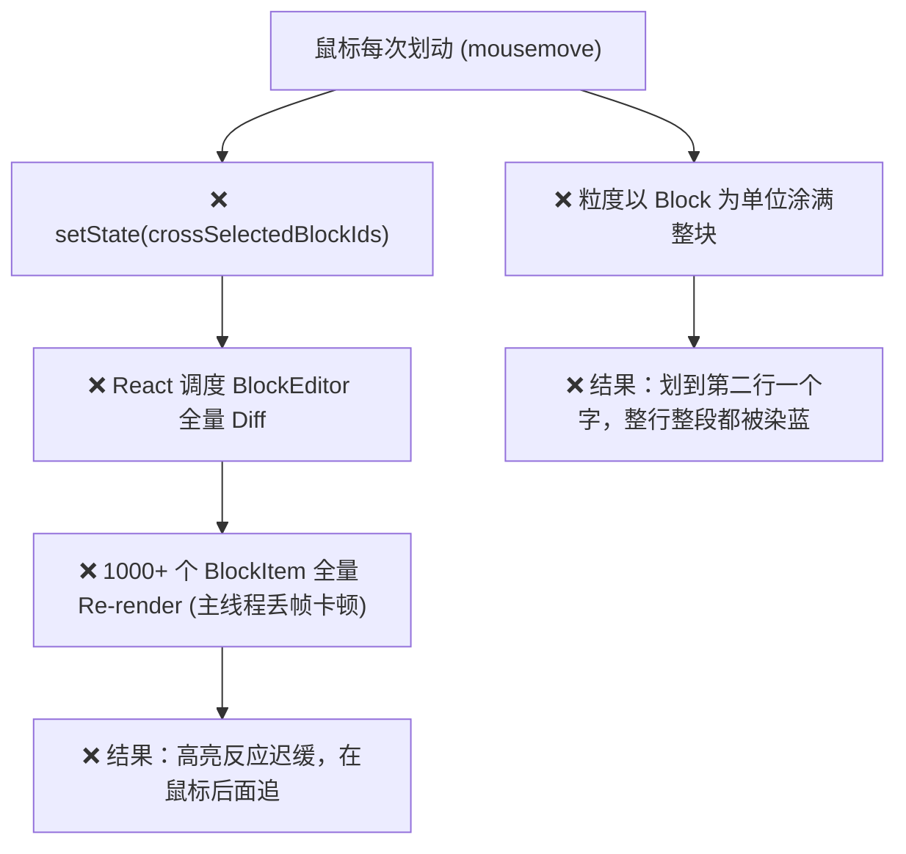
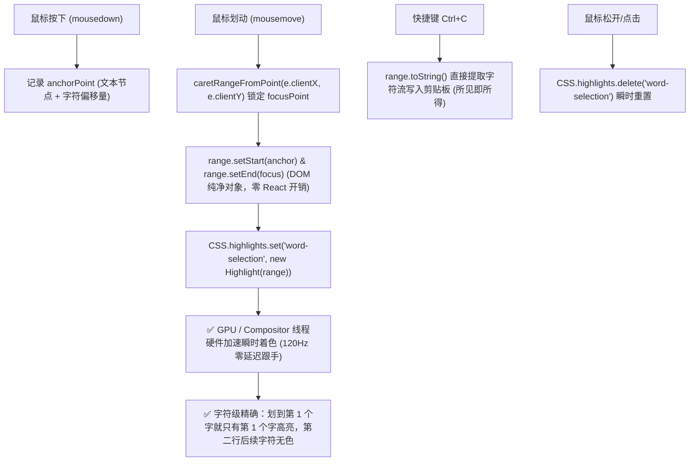

# 技术架构与设计方案：字符级精准高亮与零延迟即划即现引擎 (Design)

## 一、 根因剖析与架构换代

### 1.1 现状性能与体验死锁


### 1.2 现代化 CSS Custom Highlight / Native Range 极速架构


---

## 二、 核心技术实现方案

### 2.1 CSS 层面定义 Custom Highlight
在 `src/styles/globals.css` 中追加 W3C 标准高亮定义：
```css
::highlight(word-selection) {
  background-color: rgba(56, 189, 248, 0.28);
  color: #f8fafc;
}
```

### 2.2 编辑器层手势驱动引擎 (`BlockEditor.tsx`)
1. **脱离 React 渲染循环的 Ref 状态管理**：
   - 维护 `activeSelectionRangeRef = useRef<Range | null>(null)`；
   - 维护 `anchorCaretRef = useRef<{ node: Node; offset: number } | null>(null)`；
2. **`mousedown` 捕获锚点字符**：
   - 当在正文内容区域点击时，通过 `document.caretRangeFromPoint(e.clientX, e.clientY)` 获取点击位置的 `node` 与 `offset`，存入 `anchorCaretRef`；
3. **`mousemove` 动态精准更新 Highlight**：
   - 使用 `document.caretRangeFromPoint(e.clientX, e.clientY)` 获取当前悬浮文本节点与偏移量；
   - 比较 `anchorNode` 与 `focusNode` 的 DOM 位置顺序，构造合法方向的 `Range`；
   - 直接执行：
     ```javascript
     const range = new Range();
     if (isForward) {
       range.setStart(anchorNode, anchorOffset);
       range.setEnd(focusNode, focusOffset);
     } else {
       range.setStart(focusNode, focusOffset);
       range.setEnd(anchorNode, anchorOffset);
     }
     activeSelectionRangeRef.current = range;
     if (typeof CSS !== 'undefined' && CSS.highlights) {
       CSS.highlights.set('word-selection', new Highlight(range));
     }
     ```
   - **完全无 `setState`，完全无组件重新渲染，延迟降至 0**！
4. **`mouseup` 与单击退出**：
   - 若只是单纯的就地单击（Range 长度为 0），清空 `CSS.highlights` 并释放引用；
   - 仅当真正产生跨段范围并在拖拽结束时，才同步必要元数据以保障上下文菜单等辅助功能；
5. **剪贴板联动与精准复制**：
   - 在 `copy` 事件处理中，若 `activeSelectionRangeRef.current` 存在且非空：
     直接使用 `activeSelectionRangeRef.current.toString()`，所获取的文本完全等于当前高亮范围的字符切片，连同段落换行精准写入剪贴板！
