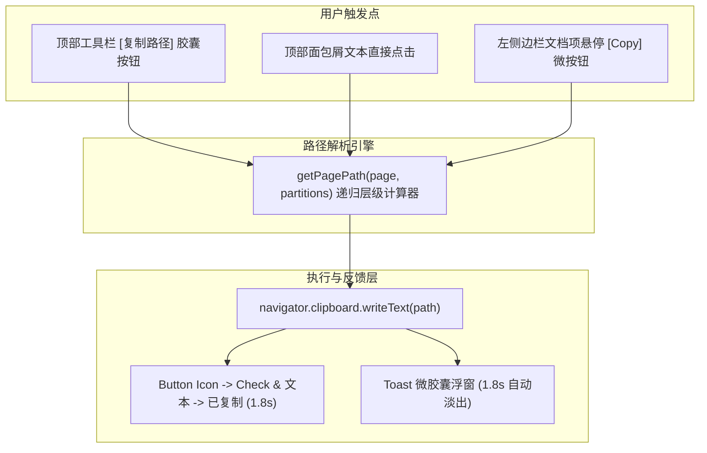

# 技术架构设计：文档路径复制与层级解析引擎 (Design Document)

## 1. 架构总览与交互流 (Architecture Overview)



---

## 2. 核心算法设计：多级分区递归层级回溯

```ts
/**
 * 根据页面与分区列表计算规范的层级路径
 */
export function getPageHierarchyPath(
  page: { title?: string; partitionId?: string },
  partitions: Array<{ id: string; name: string; parentId?: string | null }>
): string {
  const title = page.title || '未命名笔记';
  const partId = page.partitionId;

  if (!partId || partId === 'part_private') {
    return `私人 / ${title}`;
  }

  // 构建父子索引映射
  const partMap = new Map(partitions.map((p) => [p.id, p]));
  const hierarchyNames: string[] = [];

  let curr = partMap.get(partId);
  const visited = new Set<string>();

  while (curr && !visited.has(curr.id)) {
    visited.add(curr.id);
    hierarchyNames.unshift(curr.name);
    if (!curr.parentId || curr.parentId === 'part_private') {
      break;
    }
    curr = partMap.get(curr.parentId);
  }

  if (hierarchyNames.length === 0) {
    return `私人 / ${title}`;
  }

  return `私人 / ${hierarchyNames.join(' / ')} / ${title}`;
}
```

---

## 3. UI 布局与微交互设计

1. **顶部导航栏**：
   - 面包屑：包裹为可交互点击微胶囊（`hover:bg-white/5 px-2 py-1 rounded-md cursor-pointer transition-colors`），附带小型 `Copy` 图标；
   - 顶部右侧：在收藏按钮左侧增设独立 `复制路径` 胶囊（`flex items-center gap-1.5 px-2.5 py-1 rounded-md border text-xs`）；
   - 复制状态：利用 React `useState<boolean>` 控制 1800ms 绿色高亮与图标瞬变。
2. **侧栏文档列表**：
   - 在各文档项右侧的悬停按钮区（原仅有收藏与删除），插入 `Copy` 按钮（`title="复制文档路径"`），点击时通过 `e.stopPropagation()` 阻止触发页面切换。
3. **全局轻量 Toast**：
   - 状态：`toast: { text: string; visible: boolean } | null`；
   - 样式：右下角极简暗色毛玻璃悬浮条（`bg-slate-900/95 border border-white/10 text-emerald-300 text-xs shadow-2xl rounded-lg px-3 py-2 flex items-center gap-2 backdrop-blur-md`）。

---

## 4. 影响范围与爆炸半径评估 (Blast Radius Analysis)
- **直接修改文件**：
  - `src/components/DocsView.tsx`（添加路径解析纯函数、顶部复制按钮、侧栏快捷按钮及 Toast 提示组件）。
- **承诺保留现状**：
  - 核心文档编辑内核（`BlockEditor.tsx` / `TableBlock.tsx` / `BlockItem.tsx`）保持现状；
  - 后端 Rust `src-tauri/src/db.rs` 单元测试保持只读；
  - 选区与样式渲染保持绝对稳定。
