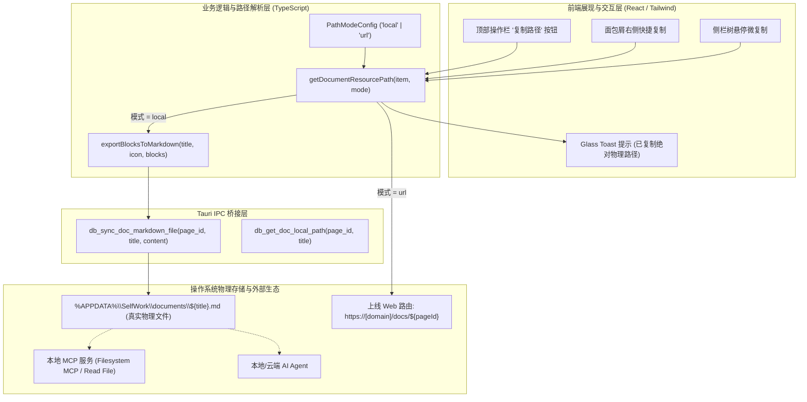

# Design: Docs Local Physical Path Mirroring and URL Architecture

## 1. 架构拓扑 (Architecture Topology)

## 2. 关键模块设计与实现细节

### 2.1 Rust 后端支持 (`src-tauri/src/db.rs` & `src-tauri/src/lib.rs`)
在 Rust 端新增受控目录治理函数与 Tauri Commands：
- `get_documents_dir() -> PathBuf`: 基于 `%APPDATA%\SelfWork\documents` 自动创建并返回安全目录路径。
- `sanitize_filename(name: &str) -> String`: 过滤 Windows 文件系统保留字符（`\ / : * ? " < > |`）并截断防止过长。
- `db_sync_doc_markdown_file(page_id: String, title: String, content: String) -> Result<String, String>`: 将内容写入物理文件并返回绝对路径规范字符串（`C:\Users\...`）。
- `db_get_doc_local_path(page_id: String, title: String) -> Result<String, String>`: 快速计算预期物理路径。

### 2.2 前端路径与同步服务 (`src/services/docPathService.ts`)
新建独立的无副作用服务模块 `src/services/docPathService.ts`：
- `resolveDocumentLocalPath(pageId: string, title: string, blocks?: DocBlock[]): Promise<string>`
  - 若提供了 blocks，调用 `exportBlocksToMarkdown` 转换并通过 `db_sync_doc_markdown_file` 同步最新物理文件；
  - 返回 Windows 真实绝对路径；
- `resolveDocumentUrlPath(pageId: string): string`
  - 构造 `${window.location.origin}/#/docs/${pageId}` 或环境变量配置的在线 URL；
- `copyDocumentResource(options): Promise<{ path: string; mode: 'local' | 'url' }>`
  - 统一执行剪贴板写入并派发状态。

### 2.3 `DocsView.tsx` 协同改造
- 废弃 `getItemHierarchyPath` 作为复制输出；将其重命名为 `getItemBreadcrumbText` 仅供顶部视觉面包屑纯展示；
- 顶部工具栏按钮改用 `handleCopyDocumentPath`，统一调用 `docPathService`；
- 侧边栏所有悬停复制按钮同步挂载该调用；
- Toast 明确呈现复制的完整 Windows 路径，且带有“可由 MCP+AI 直接读取”的高质感知。
