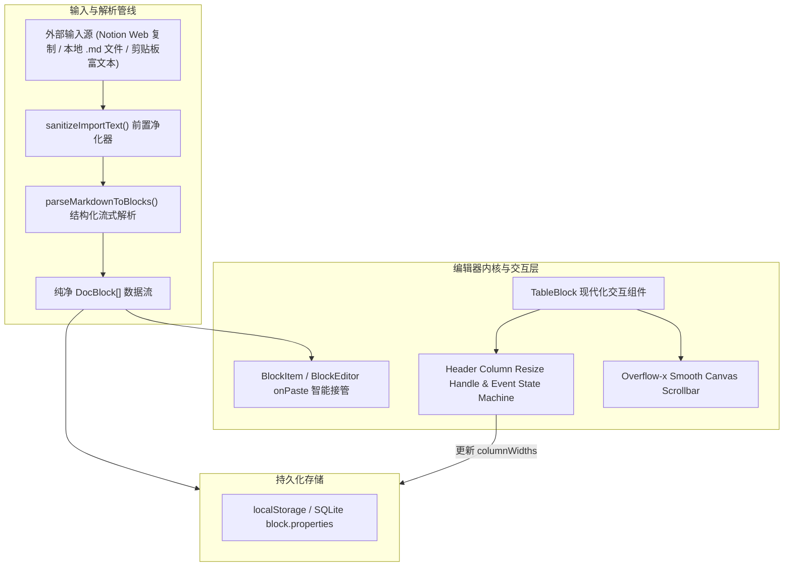

# 技术架构设计：导入语义清洗、表格防畸变与列宽拖拽交互 (Design Document)

## 1. 架构总览与分层设计 (Architecture Overview)



---

## 2. 关键模块实现方案

### 2.1 语义净化过滤器 `sanitizeImportText(raw: string)`
位于 `src/services/markdownImport.ts`：
1. **Notion 顶栏外壳清洗**：
   - 匹配第一行或前导段落中的外壳特征：
     ```regex
     ^(?:废纸篓\s*)?(?:私人|工作区|空间)?\s*[\/／]\s*(.*?)(?:·\s*\d+\s*个块)?(?:目录大纲\(\d+\))?(?:[\s\S]*?(?:添加封面|添加图标|添加评论))?
     ```
   - 提取可能存在的图标（如 `[\u{1F300}-\u{1F9FF}]`）与文档标题；
   - 过滤孤立的元数据行：`^\s*(?:·\s*\d+\s*个块|目录大纲\(\d+\)|添加封面|添加图标|添加评论|移至废纸篓)\s*$`。
2. **代码块 Header 噪点剥离**：
   - 匹配特征：`(Python|JavaScript|TypeScript|Rust|SQL|HTML|CSS|Bash|Shell|JSON|YAML|Plain\s*Text)?\s*(?:不换行|换行)?\s*(?:行号)?\s*复制\s*\d*`
   - 将行首附着的该类噪点剥离，如果前文有语言标签，自动转换为规范 Markdown 代码围栏：
     ````python\n# 代码正文\n````
3. **表格 UI 噪点剔除**：
   - 剥离 `数据表格\s*\d+\s*列\s*×\s*\d+\s*行\s*(?:首行表头)?\s*(?:复制\s*MD)?\s*(?:加列)?\s*(?:加行)?`。

### 2.2 表格安全切分与防克隆算法
1. 替代简单的 `line.slice(1, -1).split('|')`，采用正则表达式：
   ```ts
   // 基于负向后行断言，只有未被转义的 | 才作为列分隔符
   const rawCells = line.slice(1, -1).split(/(?<!\\)\|/);
   const cells = rawCells.map(c => c.replace(/\\\|/g, '|').trim());
   ```
2. 表格规整对齐：
   - 收集表格所有行，取有效列数最大值作为 `targetCols`；
   - 补全每行至 `targetCols`；
   - 若发现连续两行内容完全相同且符合表头模式，自动去重，杜绝克隆。

### 2.3 `TableBlock` 列宽拖拽状态机设计
1. **数据模型扩展**：
   在 `block.properties` 中增加：
   ```ts
   interface TableBlockProperties {
     rows: string[][];
     hasHeaderRow?: boolean;
     columnWidths?: number[]; // 每列宽度（像素值）
   }
   ```
2. **状态机流转**：
   ```mermaid
   stateDiagram-v2
       [*] --> Idle
       Idle --> Resizing : onMouseDown (在 Resize Handle 上)
       Resizing --> Resizing : onMouseMove (计算 deltaX, Math.max(60, startWidth + deltaX))
       Resizing --> Idle : onMouseUp (解除全局监听, 触发 onUpdate 持久化)
   ```
3. **DOM 渲染**：
   - 容器包裹：`className="overflow-x-auto custom-scrollbar"`
   - 内部表格设置 `style={{ tableLayout: 'fixed', width: sum(widths), minWidth: '100%' }}`
   - 使用 `<colgroup>` 定义各列宽度：`<col style={{ width: `${w}px` }} />`
   - 表头右侧绝对定位 4px 交互把手：`w-1.5 cursor-col-resize hover:bg-sky-500/50`。

---

## 3. 依赖与影响范围评估 (Blast Radius Analysis)
- **直接修改文件**：
  1. `src/services/markdownImport.ts`：增加净化器与健壮表格解析；
  2. `src/components/docs/editor/TableBlock.tsx`：增加列宽调整与平滑横向滚动；
  3. `src/components/docs/editor/BlockItem.tsx`：增加对段落块粘贴多行 Markdown 的智能解析分裂；
  4. `src/components/docs/editor/BlockEditor.tsx`：支持多块连续插入接口（`handleInsertBlocks`）。
- **承诺保留现状**：
  - `src-tauri/src/db.rs` 14 个测试用例绝对只读；
  - 选区系统（W3C Custom Highlight API、单权威法理、段落级无边框自然高亮）100% 保持现状；
  - 大纲树折叠逻辑与历史快照系统保持现状。
