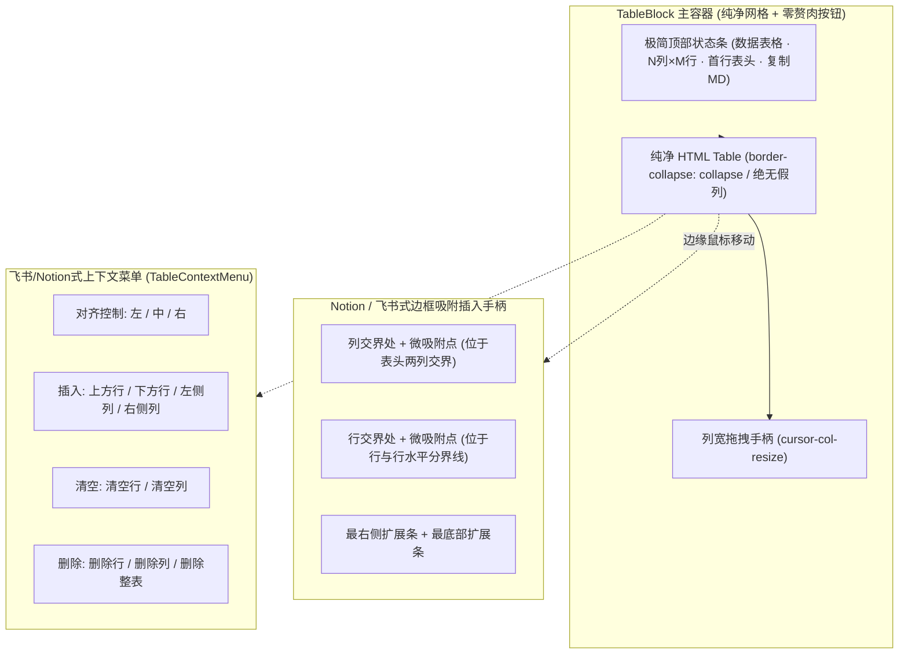

# Design: Notion/Feishu/Word Grade Table Architecture

## 1. 架构拓扑 (Architecture Topology)



## 2. 边框严丝合缝与消除断点的几何设计

### 2.1 彻底剔除操作列
旧代码：
```html
{rowCount > 1 && <col style={{ width: '52px' }} />}
...
{rowCount > 1 && <td className="w-13 px-1 ... border-transparent">...</td>}
```
新架构：
彻底删除这一列！`colgroup` 中只严格映射真实的数据列 `localWidths.map(...)`。
不再有任何假列，最右侧单元格就是表格的物理终点。

### 2.2 边框像素闭合设计
```css
table {
  border-collapse: collapse;
  border-spacing: 0;
  border: 1px solid rgba(255, 255, 255, 0.1);
  table-layout: fixed;
}
td {
  border: 1px solid rgba(255, 255, 255, 0.08);
  padding: 8px 12px;
}
tr:hover {
  background-color: rgba(255, 255, 255, 0.02);
}
```
所有水平网格线从左到右 100% 贯通，所有垂直网格线从上到下 100% 闭合，绝无断点！

## 3. Notion / 飞书式边框吸附微手柄交互

### 3.1 列交界手柄 (Between Columns)
在表头单元格的右侧边框上方，放置一个绝对定位容器：
- 平时透明隐藏 `opacity-0`；
- 当鼠标悬停在表头两列交界线（宽 12px 区域）时，浮现圆圈 `+`（`w-4 h-4 rounded-full bg-sky-500 text-white flex items-center justify-center shadow-lg -translate-x-1/2 -top-2`）；
- 点击该 `+`：调用 `handleInsertCol(cIdx, 'right')`！

### 3.2 行交界手柄 (Between Rows)
在每行左侧边框外或下部分割线上：
- 悬停在行与行交界线上时，在左侧浮现圆圈 `+`；
- 点击该 `+`：调用 `handleInsertRow(rIdx, 'below')`！

## 4. 上下文菜单 (Context Menu) 状态设计
```ts
const [contextMenu, setContextMenu] = useState<{
  x: number;
  y: number;
  rIdx: number;
  cIdx: number;
} | null>(null);

const handleContextMenu = (e: React.MouseEvent, rIdx: number, cIdx: number) => {
  e.preventDefault();
  setContextMenu({ x: e.clientX, y: e.clientY, rIdx, cIdx });
};
```
弹出轻量现代暗黑菜单，用完即关。
