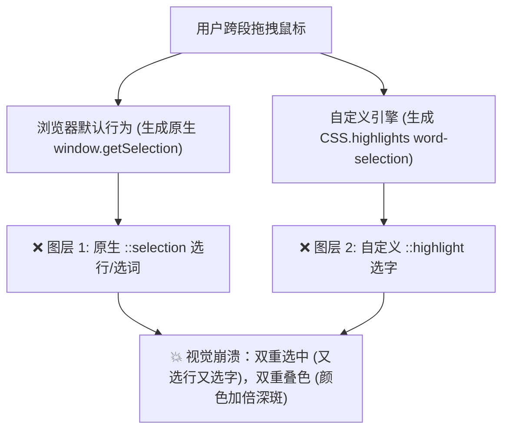
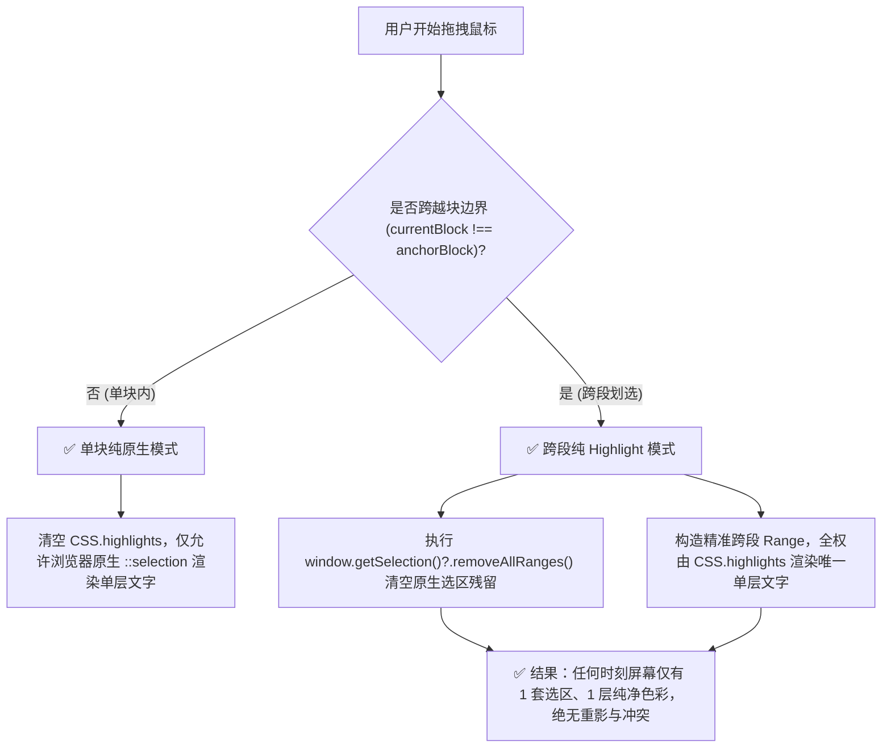

# 技术架构与设计方案：选区单一权威归一化与消除双重高亮 (Design)

## 一、 双重高亮根因拓扑与互斥重构

### 1.1 冲突拓扑


### 1.2 互斥归一化单一权威拓扑


---

## 二、 核心技术方案细节

### 2.1 运行时无感知互斥切换 (`BlockEditor.tsx`)
在 `handleGlobalMouseMove` 内部：
```typescript
if (anchorBlockEl && currentBlockEl && anchorBlockEl === currentBlockEl) {
  // 单块内：清空自定义 highlight，全权由原生选区单层渲染
  if (activeSelectionRangeRef.current) {
    activeSelectionRangeRef.current = null;
    if (typeof CSS !== 'undefined' && (CSS as any).highlights) {
      (CSS as any).highlights.delete('word-selection');
    }
  }
  return;
}

// 跨块划选：第一步必须立即清空浏览器原生的选区残留！
const nativeSel = window.getSelection();
if (nativeSel && nativeSel.rangeCount > 0) {
  nativeSel.removeAllRanges();
}

// 第二步：构造精准跨块 Range，全权交由 CSS.highlights 进行单层硬件加速渲染
const range = new Range();
const pos = anchor.node.compareDocumentPosition(focusNode);
if (pos & Node.DOCUMENT_POSITION_FOLLOWING || (anchor.node === focusNode && anchor.offset <= focusOffset)) {
  range.setStart(anchor.node, anchor.offset);
  range.setEnd(focusNode, focusOffset);
} else {
  range.setStart(focusNode, focusOffset);
  range.setEnd(anchor.node, anchor.offset);
}

activeSelectionRangeRef.current = range;
if (typeof CSS !== 'undefined' && (CSS as any).highlights) {
  const HighlightCtor = (window as any).Highlight || (globalThis as any).Highlight;
  if (HighlightCtor) {
    (CSS as any).highlights.set('word-selection', new HighlightCtor(range));
  }
}
```

### 2.2 彻底解耦 `crossSelectedBlockIds` 对 UI 的任何样式污染
- 确保 `BlockItem.tsx` 绝对不因为 `isCrossSelected` 渲染任何多余的行边框或背景；
- `isCrossSelected` 仅保留侧边把手静默退后（`pointer-events-none !opacity-0`）的辅助功能；
- 无论代码块还是普通文本块，高亮完全统一交给单层的 `::highlight(word-selection)`，杜绝任何组件级多余着色。
