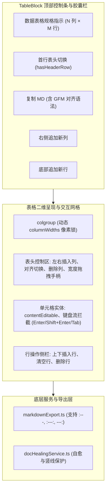

# Design: Docs Advanced Table Editing Engine Architecture

## 1. 架构拓扑 (Architecture Topology)



## 2. 状态结构设计

在 `DocBlock.properties` 中扩展：
```ts
interface TableBlockProperties {
  rows: string[][];
  hasHeaderRow?: boolean;
  columnWidths?: number[];
  columnAlignments?: ('left' | 'center' | 'right')[];
}
```

## 3. 关键交互逻辑实现方案

### 3.1 任意插入行
```ts
const insertRow = (targetIdx: number, position: 'above' | 'below') => {
  const insertAt = position === 'above' ? targetIdx : targetIdx + 1;
  const newRow = Array(colCount).fill('');
  const nextRows = [...rows.slice(0, insertAt), newRow, ...rows.slice(insertAt)];
  updateRows(nextRows);
};
```

### 3.2 任意插入列
```ts
const insertCol = (targetIdx: number, position: 'left' | 'right') => {
  const insertAt = position === 'left' ? targetIdx : targetIdx + 1;
  const nextRows = rows.map((r, rIdx) => {
    const defaultVal = rIdx === 0 && hasHeaderRow ? `列 ${colCount + 1}` : '';
    return [...r.slice(0, insertAt), defaultVal, ...r.slice(insertAt)];
  });
  const nextWidths = [...localWidths.slice(0, insertAt), defaultColWidth, ...localWidths.slice(insertAt)];
  const nextAligns = [...alignments.slice(0, insertAt), 'left' as const, ...alignments.slice(insertAt)];
  setLocalWidths(nextWidths);
  updateRows(nextRows, nextWidths, nextAligns);
};
```

### 3.3 列对齐切换与 GFM Markdown 输出
```ts
const toggleAlignment = (cIdx: number) => {
  const current = alignments[cIdx] || 'left';
  const nextMap: Record<string, 'left' | 'center' | 'right'> = {
    left: 'center',
    center: 'right',
    right: 'left',
  };
  const next = nextMap[current] || 'left';
  const updated = [...alignments];
  updated[cIdx] = next;
  updateRows(rows, localWidths, updated);
};
```
在导出 Markdown 时：
```ts
const getAlignMarker = (align?: string) => {
  if (align === 'center') return ':---:';
  if (align === 'right') return '---:';
  return ':---';
};
```
