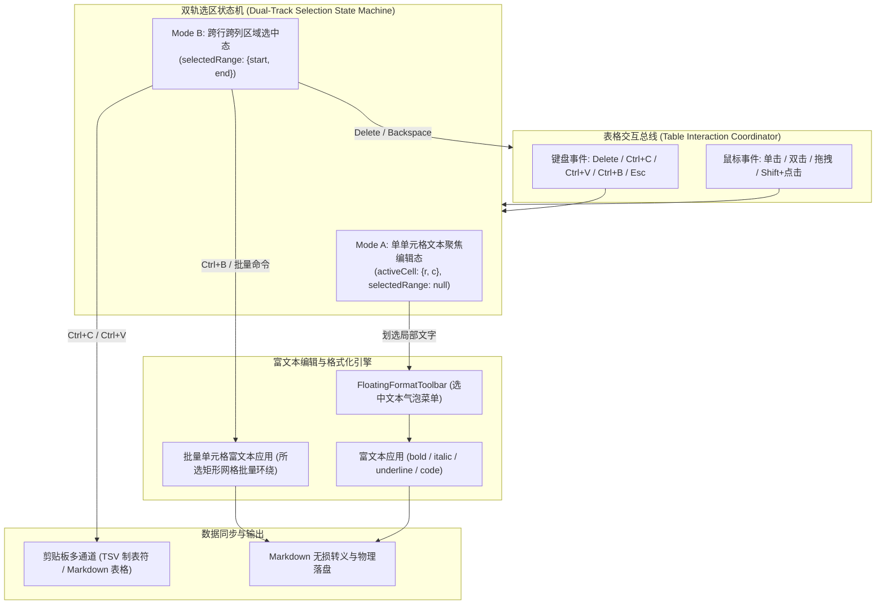

# Design: Docs Table Cross-Cell Range Selection and Rich Text Formatting

## 1. 架构拓扑 (Architecture Topology)



## 2. 双轨选区状态机状态转换 (State Transitions)

1. **进入 Mode A (单单元格编辑)**:
   - 单击某一单元格：`activeCell = { rIdx, cIdx }`，`selectedRange = null`。
   - 单元格内聚焦，光标处于文本中。
   - 鼠标划选文本：触发 `checkSelection()`，计算选区坐标 `getBoundingClientRect()` 并渲染 `FloatingFormatToolbar`。
2. **进入 Mode B (跨行跨列多选)**:
   - 方式 1：按住 Shift 单击另一单元格 `(r2, c2)` -> `selectedRange = { start: activeCell, end: { rIdx: r2, cIdx: c2 } }`。
   - 方式 2：在单元格边框/外沿按住鼠标拖拽至其他单元格 -> 动态更新 `selectedRange.end`。
   - 规范化矩形区域：
     ```ts
     const minR = Math.min(range.start.rIdx, range.end.rIdx);
     const maxR = Math.max(range.start.rIdx, range.end.rIdx);
     const minC = Math.min(range.start.cIdx, range.end.cIdx);
     const maxC = Math.max(range.start.cIdx, range.end.cIdx);
     ```
   - 处于 `[minR..maxR, minC..maxC]` 的单元格获得选区高亮样式。
3. **从 Mode B 回退到 Mode A**:
   - 单击任意单元格：多选清空，聚焦该单元格。
   - 按 `Escape`：多选清空，保持当前格聚焦。

## 3. 跨选状态下的表格编辑与文本编辑协同

1. **表格级编辑 (Table Batch Editing)**:
   - `Delete` / `Backspace`:
     ```ts
     const next = rows.map((row, r) =>
       row.map((cell, c) => (isInRange(r, c) ? '' : cell))
     );
     updateRows(next);
     ```
   - `Ctrl+C`:
     提取选区二维切片，组装为制表符分隔 TSV 格式（Excel 兼容）与标准 Markdown 表格写入剪贴板。
2. **文本级批量编辑 (Text Batch Formatting)**:
   - 在多选态下按下 `Ctrl+B` (加粗)、`Ctrl+I` (斜体)、`Ctrl+U` (下划线):
     遍历选区内每个单元格内容，若已包含对应标签则剥除，否则包裹 `<strong>` / `<em>` / `<u>`。
3. **右键上下文菜单联动**:
   - 若 `selectedRange` 存在，上下文菜单顶部显示 `已选中 ${(maxR-minR+1)*(maxC-minC+1)} 个单元格`，提供批量清空与批量对齐操作。
