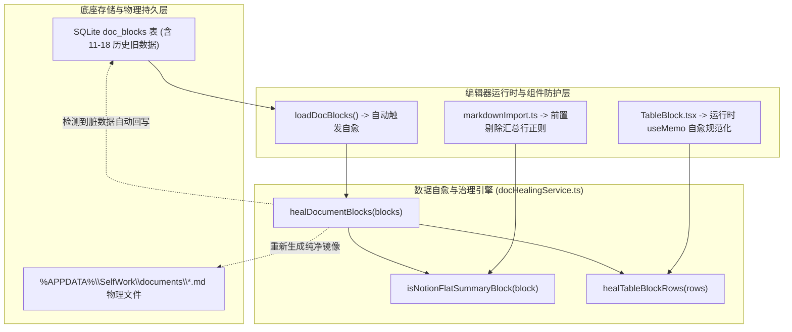

# Design: Docs Table Self-Healing and Legacy Cleansing Architecture

## 1. 架构拓扑 (Architecture Topology)



## 2. 关键算法与规整逻辑

### 2.1 Notion 扁平汇总残屑段落判定算法
```ts
export function isNotionFlatSummaryBlock(content: string): boolean {
  const trimmed = content.trim();
  if (!trimmed.startsWith('|') || !trimmed.endsWith('|')) {
    return false;
  }
  // 匹配连续重复的表头标记，如 "运算 | 运算 | Python 写法 | Python 写法"
  const doubledPattern = /([^|]+?)\s*\|\s*\1\s*\|/g;
  const matches = trimmed.match(doubledPattern);
  if (matches && matches.length >= 2) {
    return true;
  }
  // 匹配长行中同时包含 "数据表格"、"首行表头" 或大段跨列串联文本
  if (trimmed.length > 150 && trimmed.includes('运算') && trimmed.includes('Python 写法') && trimmed.includes('结果')) {
    return true;
  }
  return false;
}
```

### 2.2 表格克隆列与转义字符切裂自愈算法
```ts
export function healTableRows(rawRows: string[][]): string[][] {
  if (!rawRows || rawRows.length === 0) return rawRows;
  const header = rawRows[0];
  
  // 1. 检测表头是否为双倍克隆
  let isDoubled = header.length >= 4 && header.length % 2 === 0;
  if (isDoubled) {
    for (let i = 0; i < header.length; i += 2) {
      if (header[i].trim() !== header[i + 1].trim()) {
        isDoubled = false;
        break;
      }
    }
  }

  let cleaned = rawRows;
  if (isDoubled) {
    cleaned = rawRows.map(r => r.filter((_, idx) => idx % 2 === 0));
  }

  // 2. 修复行内 A \ 与 B 被切裂的情况
  const expectedColCount = cleaned[0]?.length || 3;
  return cleaned.map(row => {
    // 若当前行单元格过多且存在因转义竖线切开的残片，进行智能拼合
    const newRow: string[] = [];
    for (let c = 0; c < row.length; c++) {
      const cell = row[c];
      if (cell.endsWith('\\') && c + 1 < row.length) {
        newRow.push(`${cell}|${row[c + 1]}`);
        c++; // 跳过下一个被切开的单元格
      } else {
        newRow.push(cell);
      }
    }
    while (newRow.length < expectedColCount) newRow.push('');
    return newRow.slice(0, expectedColCount);
  });
}
```
