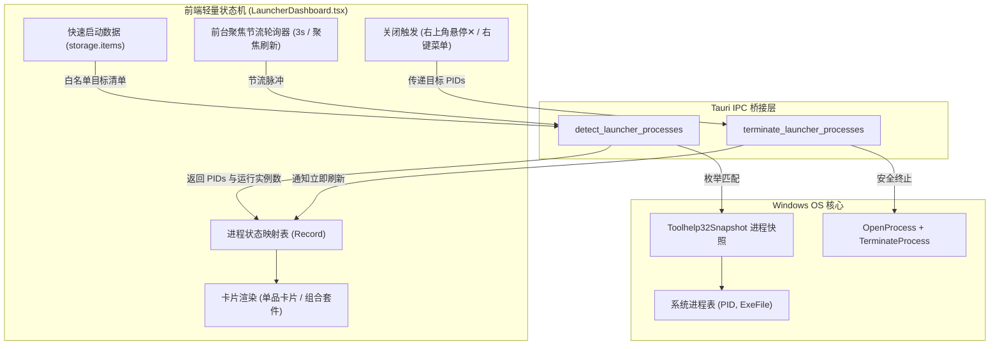
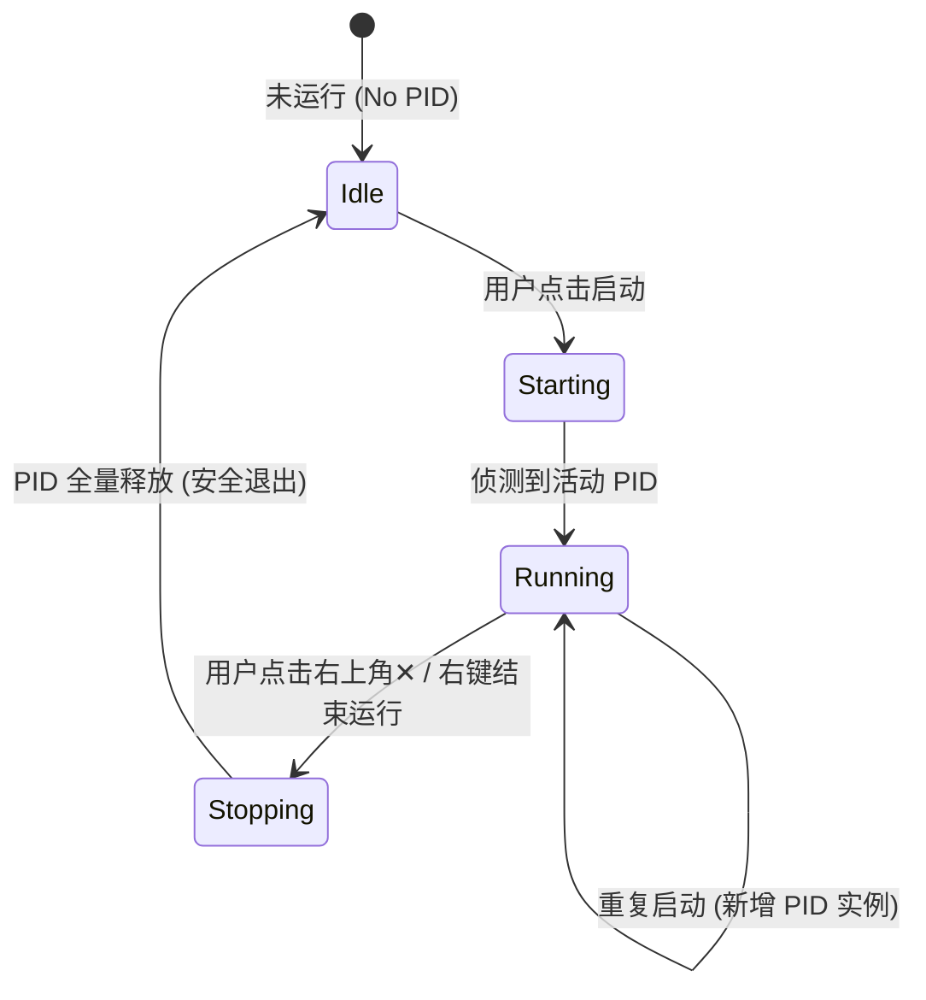

# Design: 快速启动模块纳入项进程检测与终止管理

## 1. 整体架构与因果拓扑

## 2. 状态机显式建模 (Process Lifecycle State Machine)

## 3. UI/UX 编排与人体工程学设计 (Radical Text Economy & Visual Ergonomics)

1. **单品图标右上角指示器**：
   - 在单品卡片中间图标容器 `w-10 h-10` 右上角 (`-top-1 -right-1`)，叠加绝对定位微指示层；
   - **未运行**：DOM 完全不渲染，0 视觉扰动；
   - **单实例运行中**：渲染微光祖母绿圆点 (`w-3 h-3 bg-emerald-500 rounded-full border-2 border-[#161b22] shadow-[0_0_8px_rgba(16,185,129,0.8)]`)；
   - **多实例运行中**：微胶囊徽章 (`● 2` 或 `● 3`)，指示多开实例数；
   - **鼠标悬停到右上角**：平滑变形为圆角方块或圆形的小叉号关闭微按钮（`hover:bg-rose-500/80 hover:text-white transition-all`），点击 `e.stopPropagation()` 立即杀进程；
   - **卡片右键菜单**：增设 `🔴 结束运行 (Kill)` 选项。

2. **组合套件 (Bundle Suite) 编排**：
   - 顶部/操作栏实时汇总显示子项状态：
     - 若子项全部运行：显示“全部运行中 (X/X)”；
     - 若部分运行：显示“部分运行 (M/N)”；
   - 右上角或底部操作条新增极简终止组合按钮；
   - 组合内的子项预览胶囊右侧显示微小状态绿点，支持单独悬停关闭。

3. **防误触与可重复启动**：
   - 点击卡片主体（图标除右上角外区域、卡片空白处、文字区）保持原生启动行为，不阻止用户多开窗口；
   - 终止进程限定在右上角小热区与右键菜单中，彻底避免点击应用却把正在运行的窗口关掉的灾难性误触。

## 4. 安全防护与边界防线
- **进程匹配白名单**：仅将 `storage.items` 中属于本启动台的目标 exe 发送给 Rust 校验，Rust 端严禁接受通配符或任意系统关键进程（保护 explorer.exe / svchost.exe / selfwork-desktop.exe 本身不受波及）；
- **优雅与强制终止分级**：首先尝试基于 PID 句柄优雅终止，如遇阻塞直接强制 `TerminateProcess` 保证 100% 回收；
- **低功耗节流**：仅在窗口处于前台激活时以 2.5~3 秒间隔静默刷新，窗口失焦或最小化时挂起定时器。
