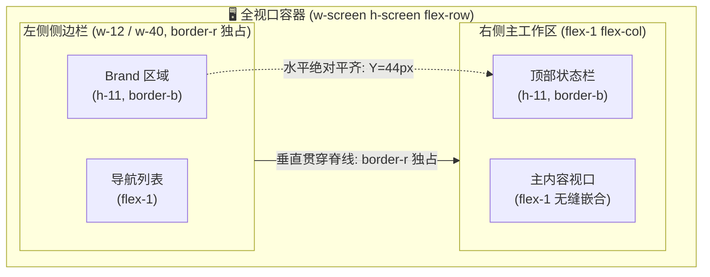

# Technical Design: Continuous Seamless Grid & Border Ownership

## 1. Single-Border Ownership Topology (单边框所有权拓扑)

## 2. 边框交汇处“十字光斑”与“粗线”根除方案
1. **统一边框色阶 (Unified Border System)**：
   - 彻底废除在局部组件上手写复合的、可能在交汇点产生叠加光晕的随意阴影；
   - 统一使用语义化设计令牌：`border-border-default`（严谨的 1px 细线，色相为 `rgba(255, 255, 255, 0.08)`）；
2. **严丝合缝的 T 字相交 (Clean T-Junction)**：
   - 侧边栏垂直右边框作为主干贯穿全屏；
   - 顶栏的水平下边线与侧边栏 Brand 的下边线均统一采用相同的 `border-b border-border-default` 与 `h-11`，形成由左至右平直贯通的绝对基准线；
3. **主舞台画板与外围结构的秩序感**：
   - `SlotContainer` 外层作为主视口，直接贴合顶部与侧面，内部保留均衡的内边距，画板采用统一的 1px 精细切削外框，拒绝任何双重边框叠加。
