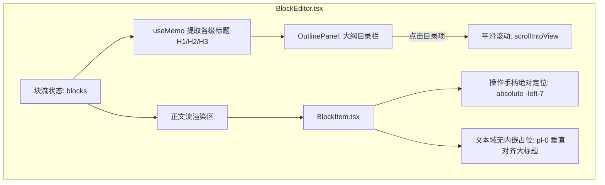

# Design: 智能大纲目录与左对齐排版架构

## 1. 架构拓扑

## 2. 大纲目录提取契约
- 提取规则：`blocks.filter(b => ['h1', 'h2', 'h3'].includes(b.blockType) && b.content.trim() !== '')`
- 层级缩进：
  - `h1`: `pl-1 font-medium text-slate-200 text-xs`
  - `h2`: `pl-4 text-slate-400 text-xs`
  - `h3`: `pl-7 text-slate-500 text-[11px]`

## 3. 左对齐几何修复方案
- 移除原本占据 32px 的 `
` 内嵌容器；
- 将操作按钮（`+` 和垃圾桶）改为绝对定位在块的左侧留白处（`absolute -left-7 top-1`）；
- 使 `textarea` 的左内边距与大标题 `input` 达到 100% 绝对平齐。
