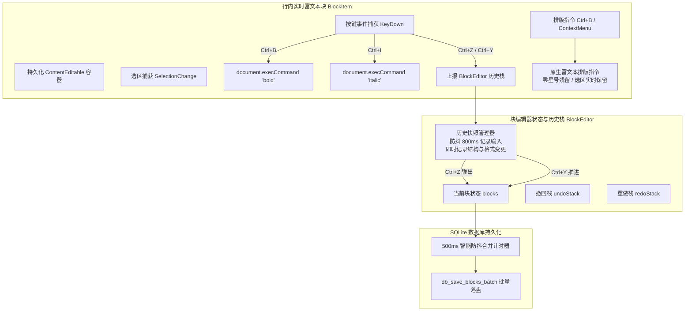

# Design: 文档编辑器行内实时渲染与撤销重做架构

## 1. 架构流转拓扑 (Architecture Topology)

## 2. 关键技术细节与反欺诈保证

1. **彻底消除 DOM 切换**:
   - 彻底废除之前的 `!isFocused ? 
 : <textarea>` 模式；
   - 块内容容器保持单一、持久挂载的 `contentEditable` 元素，彻底避免由于 DOM 卸载挂载带来的失焦与光标瞬移至末尾问题。
2. **零星号排版呈现**:
   - 排版指令使用 `document.execCommand` / DOM Selection 精准在选区包裹 `<strong>`, `<em>`, `<del>`, `<code>`；
   - 选中文本即刻视觉生效，用户绝不接触到未转义的 Markdown 代码；
3. **分层 Undo/Redo**:
   - 块内部微观文字输入：享受浏览器原生光标级别的撤回重做；
   - 块级宏观操作（格式应用、块新建、块删除、块类型转换）：由 `BlockEditor` 的全局 `HistoryManager` 严格管理。
4. **防抖持久化**:
   - 引入 `useRef<NodeJS.Timeout>` 500ms 防抖，将频繁击键合并为单一批处理事务，内存状态 0ms 响应，写库无感静默。
