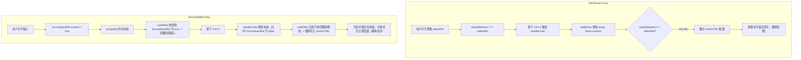

# Design: 文档编辑交互全链路加固与选区保全架构

## 1. 架构因果拓扑与根本原因穿透 (Causal Architecture)

### 1.1 撤销失效根因与双模同步拓扑

### 1.2 选区部分生效根因与防失焦工具栏拓扑
- **旧实现缺陷**：
  在 `BlockContextMenu` 中，菜单按钮为原生 `<button>`，当用户使用鼠标点击按钮时：
  1. `mousedown` 事件默认将浏览器焦点从 `contentEditable` 元素转移到菜单按钮；
  2. 焦点的转移导致浏览器原生 `Selection` 发生坍缩或被冲刷，保存的 `savedRangeRef` 在 Chromium 内部失效；
  3. 执行 `document.execCommand` 或直接操作 DOM 时，仅有首个焦点字符或局部发生改变，造成“只有部分文本有效”。
- **新架构方案**：
  1. **全链路 Mousedown 防御 (No Focus Stealing)**：
     无论是右键上下文菜单还是新增的选区浮动工具栏，所有按钮强制绑定 `onMouseDown={(e) => e.preventDefault()}`。点击操作不会触发失焦，浏览器选区在点击瞬间 100% 保持在编辑器内的选定文字上；
  2. **选区显式保全与范围重定位**：
     在执行任何格式命令前，先主动校验当前选区范围，若选区发生微偏移，则在 `editorRef.current.focus()` 后精准重新注入目标 Range；
  3. **行内代码与彻底清除格式引擎升级**：
     - 行内代码：若当前选区已有 `<code>`，点击则解除包裹；若无则创建规范内联 `<code>` 并保持选区；
     - 清除格式：不仅调用 `document.execCommand('removeFormat')`，同时遍历选区范围剥离 `<del>`、`<code>`、`` 等所有非默认装饰标签。

---

## 2. 交互组件设计：选区浮动微光工具栏 (FloatingFormatToolbar)

在用户使用鼠标完成文本划选时（`mouseUp` 且 `selection.toString().trim() !== ''`），自动计算选区坐标，在选区正上方（带防溢出检测）浮动弹出紧凑轻量微光工具条：
- **尺寸与排版**：高 32px，暗夜磨砂质感（`bg-[#0c101a]/98 backdrop-blur-2xl border border-white/20 rounded-xl`）；
- **操作项**：
  1. `[B]` 加粗 (`Bold`)
  2. `[I]` 斜体 (`Italic`)
  3. `[U]` 下划线 (`Underline`)
  4. `[S]` 删除线 (`Strikethrough`)
  5. `[</>]` 行内代码 (`Inline Code`)
  6. `[🧹]` 清除格式 (`Clear Format`)
- **生命周期**：
  - 用户点击编辑器任意非选区空白、按键盘任意按键或选区折叠为光标时，自动淡出销毁；
  - 避免与右键菜单冲突（右键时优先展示包含 Turn into 的完整上下文菜单）。

---

## 3. 撤销历史栈精细化分词与防抖调度

在 `BlockEditor.tsx` 中：
1. **撤销快照策略**：
   - 结构性变更（格式排版、块转换、新增块、删除块）：立即压入 `undoStackRef`；
   - 连续输入打字：在遇到标点、空格、换行或停顿超过 800ms 时切分快照节点，保证 `Ctrl+Z` 能够像原生文字处理软件一样逐词/逐句撤销，而不是必须等 1.5 秒或一口气全退回；
2. **重做保护**：
   - 只要有新的输入产生，清空 `redoStackRef`；
   - 撤销动作不会触发持久化定时器冲突，立即保存以保证 SQLite 状态一致。
