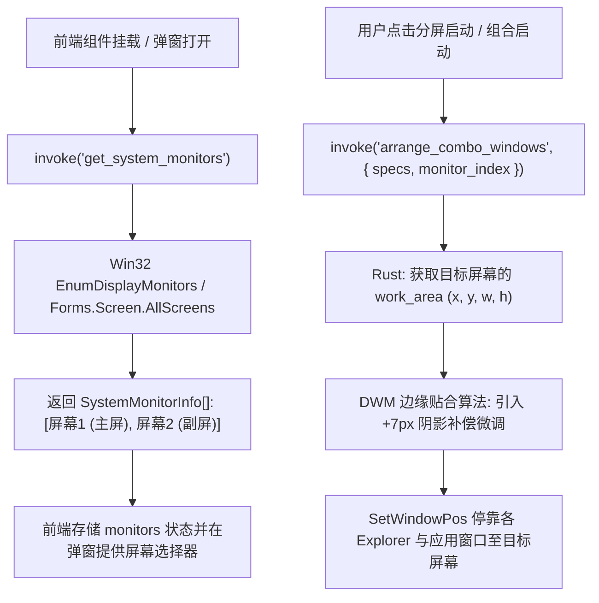

# Design: 多屏幕拓扑感知、目标屏幕定向与 DWM 无缝补偿设计

## 1. 架构因果拓扑与数据流 (Causal Topology)

## 2. 核心技术决策 (Key Technical Decisions)

### 2.1 多屏幕感知实现
- 在 Windows 平台，使用 Win32 原生 `EnumDisplayMonitors` 搭配 `GetMonitorInfoW` 获取每个显示器的 `rcWork` 与 `rcMonitor`，判断 `MONITORINFOF_PRIMARY`。
- 将屏幕按主屏优先与 X 坐标排序，生成对用户友好的名称（如：`屏幕 1 (主屏 1920×1080)`、`屏幕 2 (副屏 1920×1080)`）。

### 2.2 DWM 隐形边框消除大缝隙 (Seamless Snap Compensation)
- Windows 10/11 的 Aero/DWM 窗口管理器在每个外框附加了透明的调整大小手柄（约 7-8px）。
- 当两个窗口按纯物理像素 `w = 960` 紧贴时，视觉上各缩进 7px，形成 14px 宽的空隙。
- 补偿方案：
  - 左侧窗口宽度增加 7px (`w += 7`)；
  - 右侧窗口起始位置向左微调 7px (`x -= 7`) 且宽度增加 7px (`w += 7`)；
  - 上下分屏同理向交界处微增 7px；
  - 窗口的可视区域从而达到真正的像素级贴合（Zero Visual Gap）。

### 2.3 组合卡片排版防乱与微文案
- 顶栏徽标容器设置 `flex items-center gap-1 min-w-0 max-w-full overflow-hidden`；
- 分屏徽标采用更精炼的 Design Token：`<Monitor className="w-2.5 h-2.5" /> 田字四分`；
- 所有徽标添加 `whitespace-nowrap shrink-0` 严格禁止单字折行。
