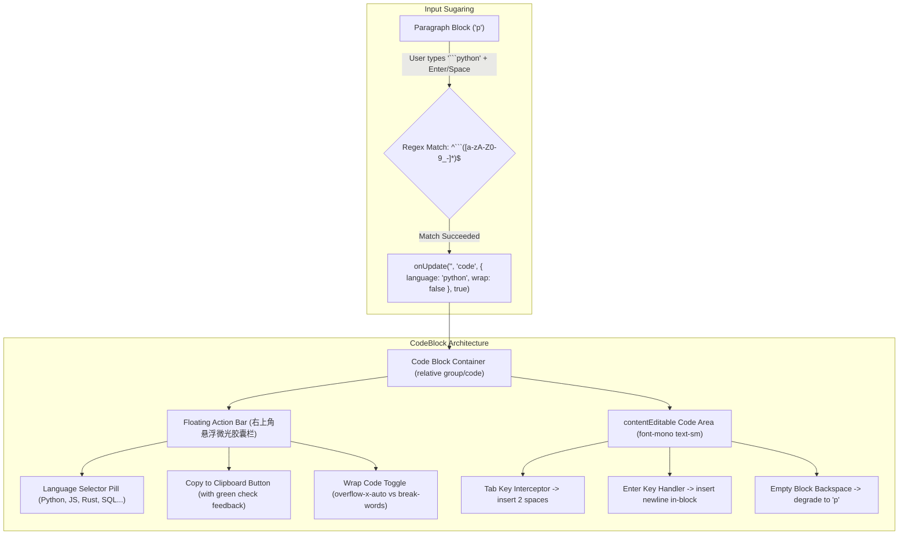

# Design: 文档中心代码块智能识别、悬浮操作胶囊与击键工学架构

## 1. 代码块组件架构与数据流拓扑图 (Component & Data Flow)



## 2. 核心技术细节与规范实现

### 2.1 语言库与支持清单 (Supported Languages)
```typescript
export const SUPPORTED_CODE_LANGUAGES = [
  { id: 'python', name: 'Python' },
  { id: 'javascript', name: 'JavaScript' },
  { id: 'typescript', name: 'TypeScript' },
  { id: 'rust', name: 'Rust' },
  { id: 'sql', name: 'SQL' },
  { id: 'shell', name: 'Bash / Shell' },
  { id: 'powershell', name: 'PowerShell' },
  { id: 'json', name: 'JSON' },
  { id: 'html', name: 'HTML' },
  { id: 'css', name: 'CSS' },
  { id: 'c', name: 'C / C++' },
  { id: 'go', name: 'Go' },
  { id: 'java', name: 'Java' },
  { id: 'markdown', name: 'Markdown' },
  { id: 'plaintext', name: 'Plain Text' },
] as const;
```

### 2.2 悬浮微光胶囊栏（Floating Action Bar）设计
- 采用 Glassmorphism 磨砂微光设计：
  `bg-slate-900/90 backdrop-blur-md border border-white/10 rounded-lg p-1 flex items-center gap-1 shadow-lg`；
- 默认在未聚焦时保持透明度 `opacity-0 group-hover/code:opacity-100 transition-opacity duration-150`；
- 语言选择器支持点击展开带毛玻璃背景的小弹出层，支持点击直接切换语言并同步至 `block.properties.language`；
- 复制按钮点击后：
  `navigator.clipboard.writeText(editorRef.current?.innerText || block.content)`；
  状态切换为 `copied: true` 并在 1.8 秒后自动复原。

### 2.3 击键工学与缩进处理
- **Tab 键插入空格**：
  使用 `window.getSelection()` 在当前光标处无缝注入两个标准空格（`'  '`），并将光标精准定位在两个空格之后；
- **回车键单块内换行**：
  阻止默认派生新块，使用 `document.execCommand('insertLineBreak')` 或 `document.createTextNode('\n')` 保障多行连续输入；
- **空块退格平滑回退**：
  若文本去除空白后为空，按 `Backspace` 直接回退为普通段落。
