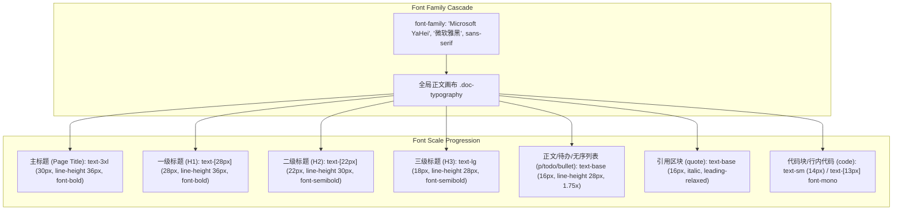

# Design: 文档中心排版美学与字号阶梯升级架构

## 1. 排版设计令牌层级体系 (Typography Token Hierarchy)



---

## 2. 核心技术落地方案 (Implementation Specifications)

### 2.1 CSS 专用字体族类定义 (`src/styles/globals.css`)
在 `globals.css` 中注入 `.doc-typography` 样式类：
```css
.doc-typography {
  font-family: "Microsoft YaHei", "微软雅黑", -apple-system, BlinkMacSystemFont, "Segoe UI", Roboto, sans-serif;
}
```
通过该专用类，使得无论操作系统语言或默认字体如何配置，文档主工作区内的所有中文和英文均强制以**微软雅黑**为最高解析优先级，中文字符笔画平滑圆润，解决默认西文字体对中文笔画造成的毛刺感。

### 2.2 块级样式字号与行高重构 (`src/components/docs/editor/BlockItem.tsx`)
```typescript
const getBlockStyle = () => {
  switch (block.blockType) {
    case 'h1':
      return 'text-[28px] font-bold text-white leading-tight';
    case 'h2':
      return 'text-[22px] font-semibold text-slate-100 leading-snug';
    case 'h3':
      return 'text-lg font-semibold text-slate-200 leading-snug';
    case 'quote':
      return 'italic text-slate-300 text-base leading-relaxed';
    case 'code':
      return 'font-mono text-sm text-rose-300 leading-relaxed';
    default:
      return 'text-base text-slate-200 leading-relaxed';
  }
};
```

### 2.3 垂直基线与前缀对齐调整
- **待办复选框 (Todo Checkbox)**：容器由原本紧凑的 `pt-1.5` 微调为完美适配 16px 文字基线的居中位置，杜绝方框偏高或偏低；
- **无序列表圆点 (Bullet Dot)**：实心圆点由 `pt-2` 调整为 `pt-2.5`，确保与 16px 正文首行文字中心平齐；
- **主标题输入框 (`BlockEditor.tsx`)**：从原 `text-2xl font-semibold` 升级为 `text-3xl font-bold`，形成压迫感适中、醒目大气的文章首焦。
