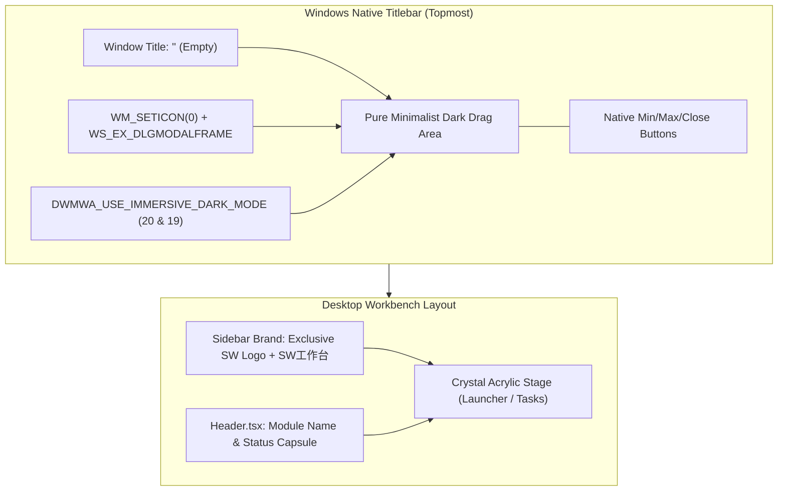

# Design: Native Titlebar Clean & Pure Drag Bar Architecture

## 1. 标题栏图文剔除与 DWM 渲染架构 (Architecture)

## 2. 界面层次对比 (Visual Contrast)

| 区域 | 变更前 | 变更后 (纯净深黑拖拽栏) |
| :--- | :--- | :--- |
| **顶部原生标题栏** | `[SW Logo] SW工作台` + `[-] [□] [X]` | **`[纯净无图标无文字深黑拖拽条]`** + `[-] [□] [X]` |
| **侧栏顶部 Brand** | `[SW Logo] SW工作台` | **`[SW Logo] SW工作台` (独家唯一品牌位)** |
| **冗余度评估** | 重复堆叠，产生视觉双胞胎 | **零视觉冗余，极简纯黑质感** |

## 3. 技术方案 (Technical Implementation Details)

1. **窗口标题清空**:
   - `tauri.conf.json`: `"title": ""`；
   - 启动时 Rust 内核再次调用 `window.set_title("")` 确保各阶段绝对无文字呈现。
2. **Win32 图标消除机制**:
   - `windows-sys` 开启 `"Win32_UI_WindowsAndMessaging"`；
   - 发送 `WM_SETICON` 将小图标与大图标置为 0；
   - 为窗体追加 `WS_EX_DLGMODALFRAME` 扩展样式，阻止 Windows 默认从 PE 资源回退读取 class icon；
   - 调用 `SetWindowPos` 带 `SWP_FRAMECHANGED` 立即通知 DWM 刷新非客户区，实现无图标纯黑拖拽栏。
