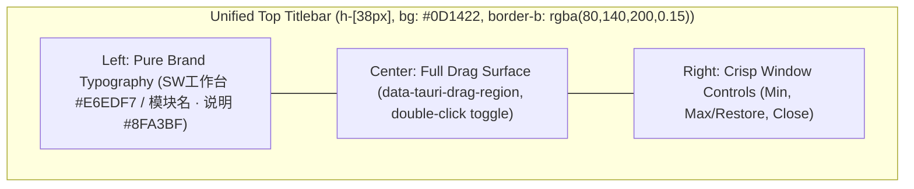

# Design: Clean Titlebar & Purged Redundant Controls

## 1. 精简后的顶栏视觉拓扑 (Purged Titlebar Layout Topology)



## 2. 元素取舍与重构矩阵 (Element Changes)

| 位置 | 改造前 | 改造后 (极简纯净控制台) | 改造理由 |
| :--- | :--- | :--- | :--- |
| **顶栏左侧前缀** | `[PanelLeft]` 侧栏折叠按钮 | **彻底移除** | 侧栏自身已包含独立收起/展开功能，消除功能重复堆砌 |
| **顶栏左侧内容** | `SW工作台 / 模块名 · 描述` | **保留并优化内边距** (`px-3`) | 作为全应用唯一顶级视觉锚点，对齐严格自然 |
| **顶栏中间区域** | 拖拽抓手区域 | **最大化扩展拖拽面积** | 释放被折叠按键与胶囊占用的水平跨度，拖拽抓手更宽阔 |
| **顶栏右侧前缀** | `[Desktop/Web]` 探测胶囊 + 分隔线 | **彻底移除** | 消除技术性状态指示对黄金视觉视野的干扰 |
| **顶栏右侧尾部** | 最小化、最大化、关闭三按键 | **保留极简细线条按键** | 平时暗调克制，关闭按键 Hover 触发柔和暗红 |

## 3. 组件接口简化 (Component Interface Simplification)

`Titlebar.tsx` 不再需要接收与侧栏折叠相关的 `sidebarCollapsed`、`onToggleSidebar` 以及状态胶囊的 `kernelStatus`、`onRefreshKernel`，接口精炼为：
```typescript
interface TitlebarProps {
  activeModule: ModuleId;
}
```
使组件高内聚、低耦合，完全符合专业桌面设计规范。
