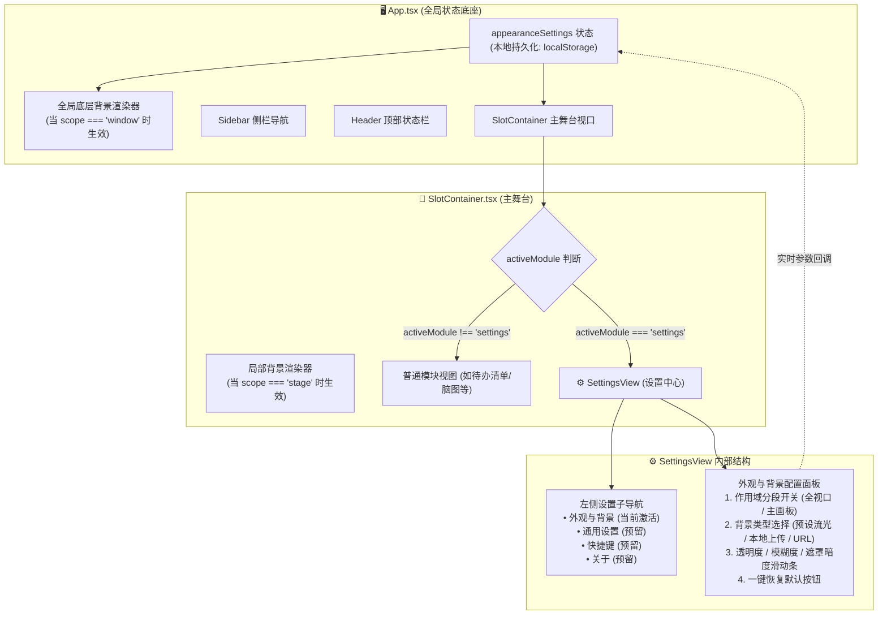

# Technical Design: Custom Background and Appearance Settings

## 1. Component Topology & Data Flow (组件拓扑与数据流)



## 2. 状态结构与持久化模型 (`src/types/settings.ts`)

```typescript
export type BackgroundScope = 'window' | 'stage';
export type BackgroundType = 'fluid' | 'image_upload' | 'image_url';

export interface AppearanceSettings {
  scope: BackgroundScope;
  type: BackgroundType;
  imageUrl: string;
  opacity: number;        // 0.0 ~ 1.0 (画板透明度)
  blur: number;           // 0 ~ 40 (高斯模糊 px)
  overlayDarkness: number;// 0.0 ~ 0.8 (深色防眩遮罩)
}
```

## 3. 防眩遮罩与双模背景渲染公式
1. **背景分层渲染物理学**：
   - 最底层：背景图片（`object-cover`）或动态流光发生器；
   - 中间层：可调节深色遮罩（`bg-black`，透明度绑定 `overlayDarkness`）；
   - 表面层：磨砂高斯模糊（`backdrop-filter: blur(Npx)`）+ 晶体玻璃高光边框；
   - 顶层：文字、图标与交互控件。
2. **极简优雅滑动条 (Sleek Glass Range Input)**：
   - 纯 CSS 定制 Range Input 轨道与触觉滑块，融入黑灰白亚克力设计令牌，拖拽手感丝滑。
