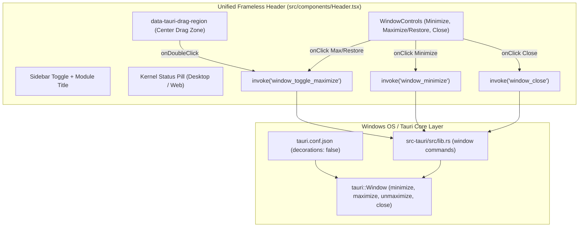
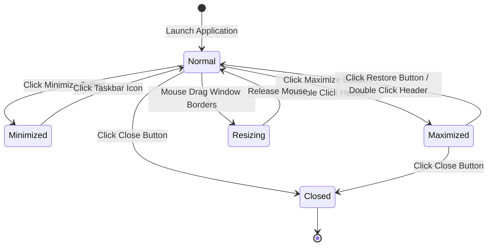

# Design: Frameless Custom Titlebar Architecture

## 1. 架构因果拓扑与状态机 (Causal Topology & State Machine)

## 2. 状态机转移图 (Window State Transition)

## 3. 几何布局与空间对齐 (Geometry & Layout Hierarchy)

- **基准高度与单边框咬合**:
  - `Header` 高度严格维持 `h-11`（44px），与 `Sidebar` 顶端 Brand 区域 `h-11` 完全对齐；
  - 移除了 Windows 原生 32px 浅灰色外壳，直接为内容工作台释放可用垂直高度；
- **自适应水平分区**:
  - 左侧：折叠展开按钮 + 当前模块标题（“快速启动”或“待办清单”），`shrink-0`；
  - 中间：动态自适应拖拽区域 `flex-1 h-full min-w-[40px]`，挂载 `data-tauri-drag-region` 与 `onDoubleClick`；
  - 右侧：状态探测胶囊 + 微弱垂直分割线（`h-3.5 w-px bg-white/[0.08]`）+ 窗口控制按钮组（最小化、最大化/还原、关闭），`shrink-0`；
- **防吞没机制 (Anti-Swallow Protection)**:
  - 窗口控制按钮与状态胶囊均设为独立的非拖拽热区，阻止拖拽事件劫持点击事件；
- **细线条原生几何图形 (Crisp Geometry)**:
  - 采用 1.2px 精准描边 SVG 渲染，杜绝厚重模糊。

## 4. 技术方案权衡与容灾 (Trade-offs & Fallback)

1. **Rust 原生 IPC 命令优先于前端权限 capabilities**:
   - Tauri v2 若直接使用 `@tauri-apps/api/window`，需要显式配置复杂的 capabilities 权限字典，容易因权限配置缺失产生运行时静默报错；
   - 通过在 Rust `lib.rs` 中直接暴露 `window_minimize`, `window_toggle_maximize`, `window_close`, `window_is_maximized` 原生命令，完全由 Rust 内核通过 `tauri::Window` 执行，零权限限制、零黑客手段、100% 稳定可靠；
2. **纯 Web 预览环境降级兼容**:
   - 在非 Tauri 环境下（Web Preview），窗口控制按钮提供优雅的 Console 提示或静默降级，不阻断前端渲染。
