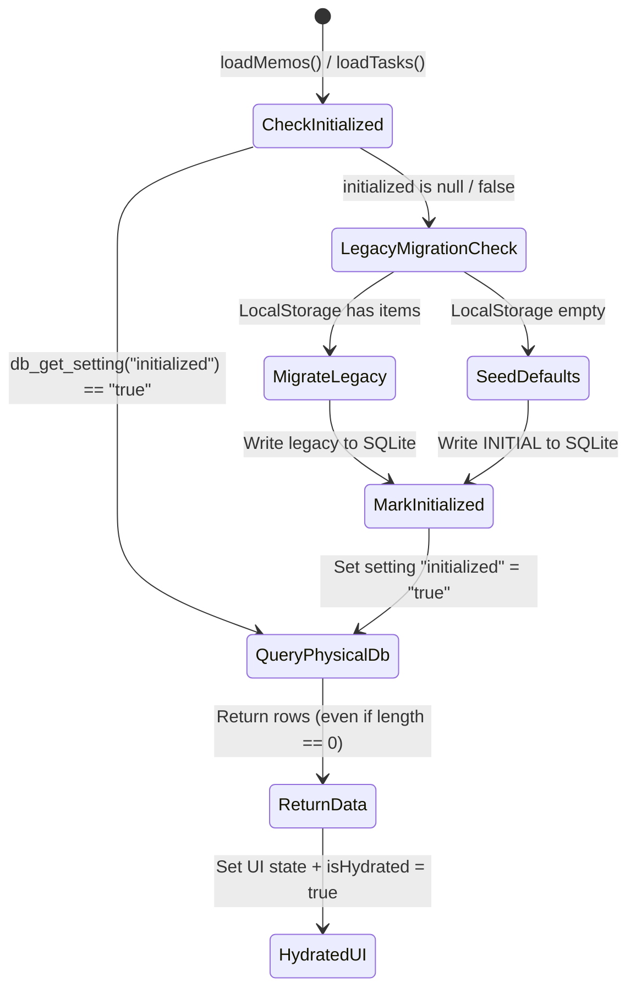

# Design: 生命周期状态机与即时持久化架构方案

## 1. 架构因果拓扑与状态机

### 1.1 数据加载状态机 (Hydration & Seeding Lifecycle)

### 1.2 为什么必须彻底废弃 `length > 0` 判定
- 在之前的逻辑中，`loadMemos` 简单使用：
  `if (Array.isArray(sqliteMemos) && sqliteMemos.length > 0) return sqliteMemos;`
  `await saveMemos(INITIAL_MEMOS); return INITIAL_MEMOS;`
- 这构成了经典的**“空集语义坍塌（Empty Set Semantic Collapse）”**：程序把“用户主动删至 0 项”和“数据库从未初始化”两件完全不同的事情当成了同一种情况。
- 通过引入 `app_settings` 中的 `memos_initialized` 和 `tasks_initialized`，将“生命周期状态”与“数据业务行数”彻底物理隔离。

### 1.3 删除即时持久化机制 (Immediate Atomic Deletion)
- 键盘输入修改标题、内容等高频微操作保留 300ms 防抖，避免频繁磁盘 I/O；
- 删除（`delete`）与清空（`clear`）操作属于低频、破坏性不可逆操作，直接在状态变更触发时同步调用 `saveMemos(next)` / `saveTasks(next)`，消除关窗竞态窗口。

### 1.4 TasksView 双重防抖水合锁 (Hydration Lock)
- 引入 `isHydrated` 布尔状态守卫。
- 只有在 `loadTasks()` 与 `loadMemos()` 从 SQLite 异步读取并 `setTasks` / `setMemos` 成功后，`isHydrated` 才置为 `true`。
- `useEffect` 监听器检查 `if (!isHydrated) return;`，防止在首帧渲染与异步读取的微任务缝隙中将默认假数据冲刷回 SQLite。
