# Architecture & Design: 快速启动灵活多选启动与自定义持久化捆绑套件

## 1. 架构总览 (Architectural Overview)

本方案构建了“即时轻量交互（多选状态机）”与“永久结构化预设（Bundle 复合项）”双轨并行的灵活启动架构：

```mermaid
flowchart TD
    subgraph MultiSelectFlow["轨道一：大盘即时多选启动 (REQ-BUNDLE-01)"]
        NormalMode["大盘常规状态 (单卡点击即启)"] -->|点击多选启动| SelectMode["多选模式 (isSelectionMode=true)"]
        SelectMode -->|用户点击卡片| ToggleSelect["切换勾选 (selectedItemIds: Set)"]
        ToggleSelect -->|点击启动所选项| BatchRunner["按序调度 handleLaunchItem (微间隔 150ms)"]
        BatchRunner -->|启动完成| NormalMode
    end

    subgraph BundleItemFlow["轨道二：持久化捆绑套件 (REQ-BUNDLE-02)"]
        AddModal["新建/编辑启动项模态框"] -->|类型选择 bundle| SubItemPicker["渲染子应用复选列表 (排除自身防递归)"]
        SubItemPicker -->|保存配置| SQLite[(SQLite 持久化: bundleItemIds)]
        SQLite -->|大盘加载| BundleCard["组合卡片 (徽标: 组合 · N项)"]
        BundleCard -->|点击卡片/运行| BundleExecutor["解析 bundleItemIds 并依次拉起全部成员"]
    end
```

## 2. 状态机与关键交互设计

### 2.1 大盘即时多选交互状态机
- **模式切换**：顶栏动作区提供 `[多选启动]` 按钮，激活时切换顶栏为操作状态条（高亮已选计数、全选、启动所选、取消）；
- **卡片渲染自适应**：
  - 当 `isSelectionMode = true` 时，卡片左上角显示圆形/方角 Checkbox；
  - 勾选状态下卡片激活青蓝高亮外边框（`border-cyan-500/60 shadow-[0_0_16px_rgba(6,182,212,0.2)]`）；
  - 点击卡片执行 `toggleSelection(id)`，不触发真实进程启动。

### 2.2 持久化 Bundle 复合启动项模型
- **类型扩展**：
  - `LauncherItemType = 'app' | 'script' | 'url' | 'folder' | 'bundle'`；
  - `LauncherItem.bundleItemIds?: string[]`；
- **防死循环校验**：
  - 组合卡片内部不得包含自身（`id !== currentEditingId`），也不允许嵌套调用其他 bundle 项，仅引用基础原子项（`app`, `script`, `url`, `folder`）；
- **执行管线**：
  - `handleLaunchBundle(item)`：根据 `bundleItemIds` 提取对应的原子 `LauncherItem` 对象数组；
  - 依次触发 `handleLaunchItem(subItem)` 并附带 150ms 微间隔。
