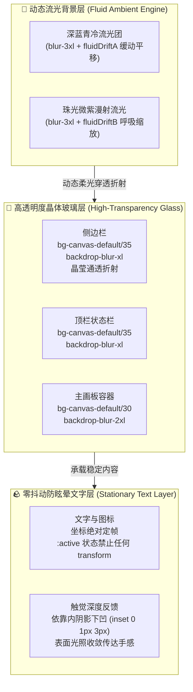

# Technical Design: High-Transparency Crystal Glass and Fluid Sheen

## 1. Crystal Glass & Fluid Mesh Architecture

## 2. 核心技术升级方案

### 1. 高透配方 (High Transparency Formula)
- 将 `--color-canvas-default` 调整为 `rgba(10, 14, 24, 0.35)`（35% 超高透光度）；
- 模糊基准由 12px 提升至 20px~24px (`backdrop-blur-xl`)，实现类似苹果 visionOS / macOS Sonoma 的高通透晶体感，使底层流动的光晕柔和穿透。

### 2. 灵动流光特效 (Fluid Light Animations)
- **底层流光池**：在 `App.tsx` 根容器内嵌 GPU 硬件加速的柔和流光发生器，两组极低饱和度的流光团（青蓝与白雾色，`blur-3xl`）在背景缓缓漂移起伏；
- **边框与高光流体反射**：激活态模块配备流光呼吸光晕，赋予界面活泼而高级的灵性。

### 3. 根除文字抖动 (Zero-Jitter Typography)
- 废除 `.tactile-btn:active` 与 `.tactile-pill:active` 中的 `transform: scale(...)` 与 `translateY(...)`；
- 按压时依靠纯光学深度变换（表面轻微收暗 + 内凹阴影加深 `inset 0 1px 3px rgba(0,0,0,0.6)`），手感干脆灵敏，文字 100% 稳如磐石，彻底消除眼球疲劳。
