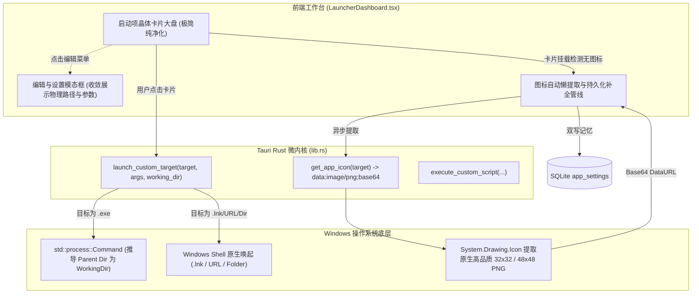

# Architecture & Design: 启动器原生可靠唤起、图标动态提取与极简纯净化设计

## 1. 架构总览 (Architectural Overview)

本方案聚焦解决 Windows 桌面端应用启动可靠性、图标视觉辨识度与界面去冗余纯净化三大诉求，构成“Rust 底座双通道增强 + 前端模型无感演进 + 极简微文案卡片重塑”的三维架构闭环：

## 2. 核心技术决策 (Core Technical Decisions)

### 2.1 解决“运行不了”的根因与方案选择
- **根因定位 (5-Whys)**：
  1. 此前采用 `cmd.exe /c start "" "target"`：Windows `cmd.exe` 在解析包裹路径时，首尾引号会被错误剥离，对于带空格的路径（如 `C:\Program Files\...`）会寻找 `C:\Program` 导致解析崩溃；
  2. 桌面程序（微信、企业微信、飞书、Xmind）启动时依赖同目录的私有 DLL 与资源。若未显式指定 `working_dir`，其继承了 `SelfWork.exe` 的工作目录，加载 DLL 失败直接静默退出；
  3. `cmd.spawn()` 仅表示 cmd.exe 进程创建成功，内部指令报错无法传递到上层。
- **治理决策**：
  - **EXE 原生启动**：通过 `std::process::Command::new(target)` 直接拉起进程；若 `working_dir` 为空，自动解析 `Path::new(target).parent()` 作为当前目录；
  - **LNK / URL / 文件夹**：通过 Windows Shell 原生唤起通道（`powershell -Command "Start-Process ..."` 或 Windows Shell 接口），确保与资源管理器双击 100% 一致。

### 2.2 原生应用图标提取架构
- **技术选型**：
  - Windows 系统原生自带 `.NET` 的 `[System.Drawing.Icon]::ExtractAssociatedIcon(path)`，能够毫秒级从任意 `.exe` 或 `.lnk` 中提取出内嵌的官方高清图标并输出为 PNG 流；
  - Rust 后端将其实现在 `get_app_icon` 中，返回 `data:image/png;base64,...`；
  - 前端在初次挂载时异步拉取并自动持久化回写至 SQLite 数据库，后续应用冷启动无需重复提取，实现 0 延迟秒级渲染。

### 2.3 极简纯净化视觉设计
- **卡片空间再平衡**：
  - 高度从 `h-44`（176px）收敛至 `h-36`（144px）紧凑晶体卡片；
  - 彻底移除卡片上的两行路径描述堆砌；
  - 视觉核心呈现：40x40 真实应用彩色图标（带优雅圆角与辉光）+ 下方粗体名称；
  - 路径与参数作为高级设置，纯粹收敛于“编辑启动项”模态框中。
