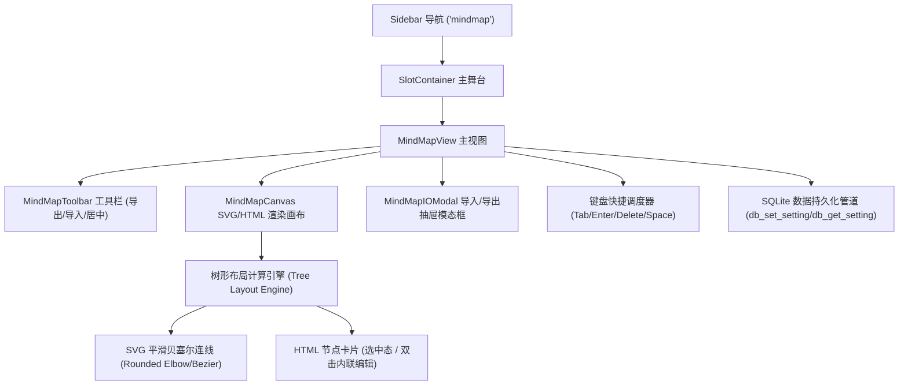
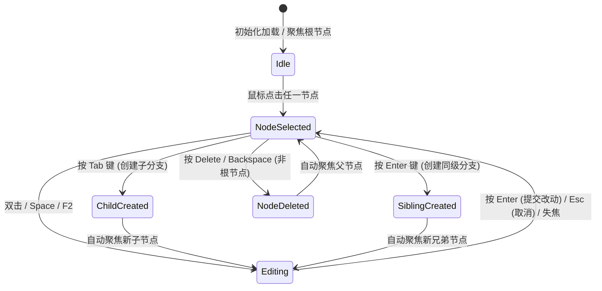

# Design Specification: mindmap-basic-editor

## 1. 架构总览 (Architecture Overview)

本变更在 SW 工作台中引入轻量、专业、沉浸深色风格的**思维导图（MindMap）模块**。
模块基于从 Xmind.exe 逆向提取的树形模型与圆角分支连接协议，采用纯前端 SVG + HTML Canvas 几何布局引擎，搭配 SQLite 健壮持久化管道，实现流畅的键盘快捷键编辑与导入导出功能。



---

## 2. 核心数据模型 (Data Model)

```typescript
export interface MindMapNode {
  id: string;
  title: string;
  children?: MindMapNode[];
  isRoot?: boolean;
}

export interface NodeLayout {
  node: MindMapNode;
  x: number;
  y: number;
  width: number;
  height: number;
  depth: number;
}
```

---

## 3. 树形布局与连接线算法 (Tree Layout & Bezier Routing)

- **水平右向树形布局 (Right-Directed Horizontal Layout)**：
  - 递归计算每个子树的垂直包围盒高度（Bounding Box Height）；
  - 每层水平间距设置为 64px，同级垂直间距设置为 16px；
  - 根节点置于左侧，各级分支整齐向右展开；
  - 父节点与子节点之间的连接线采用平滑三次贝塞尔曲线：
    `M ${startX} ${startY} C ${startX + dx * 0.5} ${startY}, ${endX - dx * 0.5} ${endY}, ${endX} ${endY}`，呈现与 Xmind 一致的优雅弧度。

---

## 4. 键盘交互状态机 (Keyboard Interaction State Machine)



---

## 5. 输入输出与持久化管线 (Input/Output & Storage Pipeline)

1. **导出 (Export)**：
   - **JSON**：输出符合标准的递归树形 JSON。
   - **Markdown**：输出按缩进层级的 Markdown 大纲（`# Root`, `## Branch`, `- Subbranch`）。
2. **导入 (Import)**：
   - 解析 JSON 树；
   - 或解析缩进式 Markdown 大纲，自动重构成标准的 `MindMapNode` 树。
3. **SQLite 持久化**：
   - 每次节点发生变更（增、删、改），触发 300ms 防抖写入 `db_set_setting('selfwork_mindmap_data', JSON.stringify(root))`；
   - 冷启动时先读取同步缓存消灭白屏，随后通过 `db_get_setting` 权威水合。
