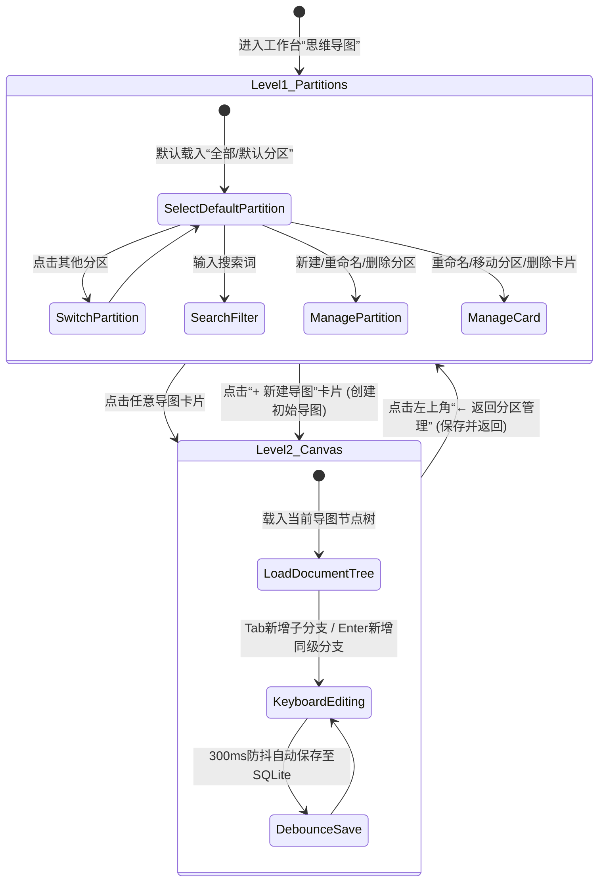

# Design: SW工作台思维导图两级页面架构与分区管理系统

## 1. Context & Architecture Overview

用户明确指示：
> “SW工作台 思维导图模块我需要把 当前的页面作为一级页面，用于思维导图的分区管理,用以创建和管理思维导图，然后通过这个一级页面点击对应思维导图进入二级页面后才是思维导图画布”

本设计在保持 SW工作台全局主导航栏（`Sidebar.tsx`）与核心外观绝对不变的前提下，对思维导图模块内部进行两级解耦分层架构改造：
- **Level-1 一级页面 (`MindMapPartitionView`)**：负责分区（Partition/Category）生命周期管理与思维导图卡片大盘（Grid）。
- **Level-2 二级页面 (`MindMapCanvas`)**：负责具体思维导图的高性能沉浸式画布编辑，继承现有纯键盘（Tab/Enter/Delete/Space/F2）流畅流转。
- **根协调器 (`MindMapView`)**：维系 `currentView: 'partitions' | 'canvas'` 与 `activeDocumentId: string | null` 状态，调度两级页面切换与存盘。

---

## 2. Component Hierarchy & Architecture Topology

```mermaid
graph TD
    App[App.tsx] --> Sidebar[Sidebar.tsx (承重墙: 绝对只读)]
    App --> MainView[主视口区域]
    
    MainView --> MindMapView[MindMapView.tsx (根协调器)]
    
    subgraph "Level-1 一级管理页面 (分区大盘)"
        MindMapView -->|currentView == 'partitions'| L1[MindMapPartitionView.tsx]
        L1 --> PartitionsSidebar[左侧分区列表管理 (新建/切换/重命名/删除)]
        L1 --> SearchBar[顶部标题搜索与过滤]
        L1 --> DocGrid[右侧导图卡片网格]
        DocGrid --> NewMapCard[首卡: + 新建导图]
        DocGrid --> MapCard[导图卡片列表 (缩略/时间/节点数/操作菜单)]
    end
    
    subgraph "Level-2 二级编辑画布 (纯净构思)"
        MindMapView -->|currentView == 'canvas'| L2[MindMapCanvas.tsx]
        L2 --> BreadcrumbBar[左上角面包屑与返回: [← 返回分区大盘] [分区名 / 导图名]]
        L2 --> CanvasArea[SVG + HTML5 贝塞尔曲线脑图画布]
        L2 --> KeyboardHandler[纯键盘流转: Tab / Enter / Delete / Space]
    end
    
    subgraph "持久化与数据总线"
        L1 -.-> DBService[db.ts / SQLite app_settings]
        L2 -.-> DBService
    end
```

---

## 3. State Machine Transitions



---

## 4. Data Model & Storage Strategy

### 4.1 数据模型定义 (`src/types/mindmap.ts`)

```typescript
// 分区模型
export interface MindMapPartition {
  id: string;             // 分区唯一UUID
  name: string;           // 分区名称 (如: "工作", "学习", "项目")
  createdAt: number;      // 创建时间戳
  isDefault?: boolean;    // 是否为不可删除的默认分区
}

// 导图文档模型
export interface MindMapDocument {
  id: string;             // 导图唯一UUID
  partitionId: string;    // 所属分区ID
  title: string;          // 导图标题
  root: MindMapNode;      // 导图节点树
  createdAt: number;      // 创建时间戳
  updatedAt: number;      // 最后更新时间戳
}

// 统一持久化存储外壳
export interface MindMapStorageData {
  partitions: MindMapPartition[];
  documents: MindMapDocument[];
  activePartitionId: string;
  activeDocumentId: string | null;
}
```

### 4.2 SQLite 存储与平滑迁移设计
- 物理存储通道利用 SQLite `app_settings` 表（键名：`sw_mindmap_storage_v2`）。
- **兼容性迁移 (Zero Data Loss Migration)**：
  - 若系统检测到旧版单导图键（`sw_mindmap_nodes`），会自动将旧导图封装为一个新的 `MindMapDocument`（标题取自旧中心主题文字），并挂载在默认分区下，确保旧版本用户的导图无缝保留。

---

## 5. Causality Mapping & Invariants

1. **绝对只读承重墙**：
   - `src/components/Sidebar.tsx` 绝对不包含任何改动。
   - `src/components/Titlebar.tsx` 绝对不包含任何改动。
2. **纯键盘交互手感保全**：
   - 二级画布内原有按键（Tab/Enter/Delete/Space/F2）事件绑定与处理链路保持 100% 不变。
3. **视觉风格一致性**：
   - 一级页面的分区侧栏与导图卡片网格严格采用工作台现有的 `bg-slate-900/60`、`border-white/5`、`hover:border-cyan-500/30` 晶体暗色设计规范，杜绝突兀色彩与白屏。
