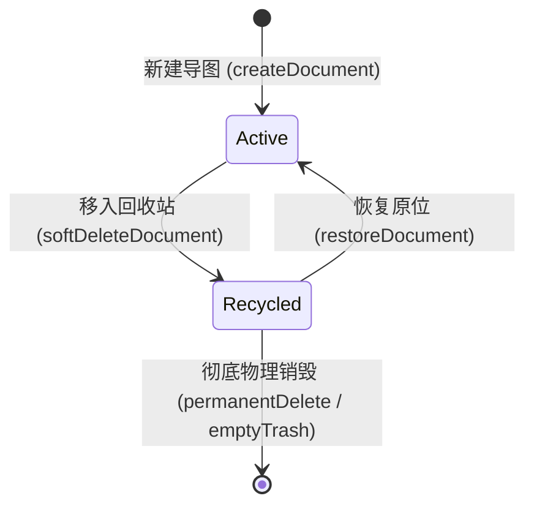

# Design: 思维导图回收站管理技术设计

## 1. 状态机模型与生命周期流转



## 2. 界面布局拓扑与侧栏设计

```
[ MindMapPartitionView 布局 ]
┌──────────────────────────┬────────────────────────────────────────────────────────────┐
│ 左侧侧栏 (w-64)          │ 右侧大盘 (flex-1)                                          │
├──────────────────────────┼────────────────────────────────────────────────────────────┤
│ h-[49px] 分区管理 [+分区]│ h-[49px] 当前分区标题 / 回收站标题 [清空回收站/搜索]        │
├──────────────────────────┼────────────────────────────────────────────────────────────┤
│ 分区列表 (可滚动)        │ 导图卡片网格                                               │
│ - 全部导图 (12)          │ [常规视图]                         [回收站视图]            │
│ - 工作规划 (5)           │  - 导图卡片 (编辑/重命名/删除)      - 废弃卡片 (原分区/时间)│
│ - 读书笔记 (7)           │                                     - 操作: [恢复] [彻底删除]│
├──────────────────────────┤                                                            │
│ 回收站固定入口           │                                                            │
│ [Trash2] 回收站  [3]     │                                                            │
└──────────────────────────┴────────────────────────────────────────────────────────────┘
```

## 3. 详细组件与数据流职责
1. **`src/types/mindmap.ts`**:
   - `MindMapDocument`: 增加 `isDeleted?: boolean`, `deletedAt?: number` 字段。
2. **`src/components/MindMapView.tsx`**:
   - `handleDeleteDocument`: 变更为软删除逻辑，更新文档 `isDeleted: true, deletedAt: Date.now()`。
   - `handleRestoreDocument`: 还原逻辑，更新文档 `isDeleted: false, deletedAt: undefined`，校验分区存在性。
   - `handlePermanentDeleteDocument`: 物理抹除逻辑，过滤掉目标 ID 文档。
   - `handleEmptyRecycleBin`: 物理清空逻辑，过滤掉所有 `isDeleted === true` 的文档。
3. **`src/components/mindmap/MindMapPartitionView.tsx`**:
   - 增加 `isViewingTrash` 状态（或将选中的分区标记为 `__trash__`）。
   - 左侧侧栏底部独立渲染“回收站”项，带有 `Trash2` 图标与当前回收站文档数量徽标。
   - 右侧大盘在回收站模式下展示已删除导图列表，提供恢复、彻底删除与一键清空按钮；空回收站展示优雅空状态。
