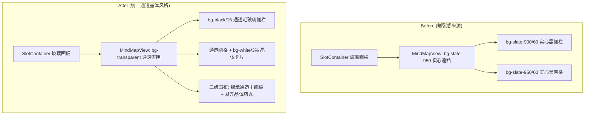

# Design: 思维导图背景与视觉调性统一对齐

## 1. 架构与视觉对齐设计

SW工作台的整体视口架构由以下层级叠加构成：
1. **底图层 (`App.tsx`)**：全视口底层流光发生器（`from-sky-500/10 via-cyan-400/8`）；
2. **主画板层 (`SlotContainer.tsx`)**：具有 `backdrop-filter: blur(Npx)` 与 `rgba(12, 16, 26, opacity)` 的圆角玻璃画板；
3. **内容层**：
   - 快速启动与待办事项均采用 `flex-1 bg-transparent`，让主画板的玻璃底色与底层流光直接通透呈现；
   - 本次改造将思维导图的根容器从 `bg-slate-950/90` 调整为 `bg-transparent`，左侧侧栏采用 `bg-black/15 border-white/[0.06]`，卡片采用 `bg-white/[0.03] hover:bg-white/[0.06] border-white/[0.08]`，二级画布采用 `bg-transparent`，使全模块与全局设计语言达到 100% 视觉统合。

---

## 2. 视觉层级对比 (Before vs After)

---

## 3. 设计令牌映射关系 (Design Tokens)

| 部件 | 既有实心色值 (Before) | 统一后晶体色值 (After) | 视觉效果 |
| :--- | :--- | :--- | :--- |
| **根容器** | `bg-slate-950/90` | `bg-transparent` | 完全透出主画板背景与底层流光 |
| **分区侧栏** | `bg-slate-900/60` | `bg-black/15 border-white/[0.06] backdrop-blur-md` | 统一的轻薄毛玻璃质感，与 Tasks 模块一致 |
| **顶部工具栏** | `bg-slate-900/30` | `bg-black/10 border-white/[0.06]` | 轻微阴影微光过渡 |
| **导图卡片** | `bg-slate-900/50 border-white/5` | `bg-white/[0.03] hover:bg-white/[0.06] border-white/[0.08]` | 悬浮微光、晶体通透 |
| **二级画布外层**| `bg-slate-950` | `bg-transparent` | 画布底色与工作台主画板完美融为一体 |
| **悬浮导航条** | `bg-slate-900/85` | `bg-black/45 backdrop-blur-md border-white/10` | 与左下角快捷键条保持 100% 材质对齐 |
