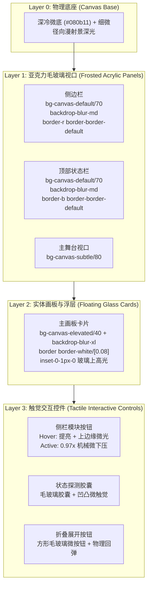

# Technical Design: Monochrome Frosted Glass and Tactile UI

## 1. Material Stack & Visual Topology (材质层级与空间拓扑)

## 2. 核心设计令牌 (Design Tokens) 升级方案
1. **黑灰白单色域 (Radical Monochrome)**：
   - 移除不必要的杂乱有色变量，保留纯粹的冷黑、深灰、锌白。
   - 品牌高光集中在必要的核心状态指示（如 Emerald 在线小绿点、SW 流体发光 Logo）与极克制的中性冷白光圈。
2. **磨砂毛玻璃层级 (Backdrop Blur & Translucency)**：
   - `backdrop-blur-md` (12px) 赋予侧栏与顶栏柔和通透感；
   - `backdrop-blur-xl` (24px) 赋予主画板深邃立体感；
   - 统一透明度：面板层采用 65%~75% 不透明度，既显通透又绝对保证文字清晰度。
3. **触觉物理学 (Tactile Button Mechanics)**：
   - **顶面内切高光 (`inset 0 1px 0 rgba(255,255,255,0.12)`)**：模拟真实机械键帽/玻璃切面顶部的物理反光；
   - **Hover 态**：表面光泽提升至 `0.18`，轻微上浮；
   - **Active 态**：`scale-[0.97]`，下凹内阴影 `inset 0 1px 2px rgba(0,0,0,0.5)`，物理下压感十足；
   - **Transition**：`duration-150 ease-out` 快速响应，杜绝拖泥带水。
