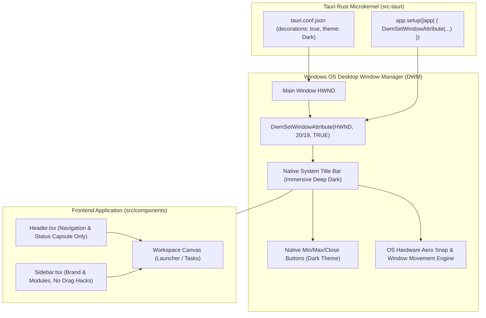

# Design: Native Dark Titlebar with DWM Immersive Dark Mode

## 1. 架构拓扑 (Architecture Topology)

## 2. 空间布局与层次对比 (Hierarchy Comparison)

| 视觉区域 | 改造前 (无边框 + 模拟拖拽) | 改造后 (原生 DWM 沉浸式深色标题栏) |
| :--- | :--- | :--- |
| **最顶层** | 前端自定义 `Header` (带细线条三键与模拟拖拽) | **Windows 原生深色标题栏**（深黑底色、白字、系统级原生三键、100% 硬件拖拽与 Aero Snap） |
| **次顶层** | 无 | **前端工作台顶栏 (`Header`)**：展示模块名称、副标说明、状态探测胶囊，与业务紧密契合 |
| **主舞台** | 晶体暗黑画板 | **晶体暗黑画板**：与上方系统深色标题栏自然过渡，无任何白边割裂 |

## 3. 技术方案确定性自证 (Technical Trade-offs)

1. **为什么 DWM 沉浸式深色模式彻底优于无边框软件模拟？**
   - 彻底解决了 Windows Webview2 内部异步通信导致的拖拽卡顿与断触问题；
   - 100% 保留 Windows 10/11 的所有原生能力：Aero Snap 边缘分屏、Win11 鼠标悬停 Snap Layouts 贴靠菜单、Alt+Space 系统窗口菜单、多显示器 DPI 自适应、原生平滑缩放与阴影；
   - Win32 原生 `DwmSetWindowAttribute` 调用耗时 $< 0.1\text{ms}$，在窗口创建瞬间完成，无白屏白条闪烁。
