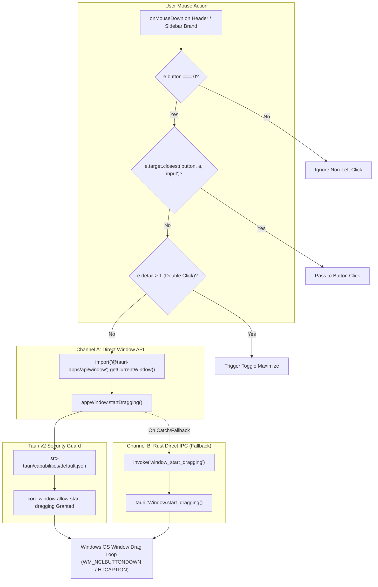

# Design: Window Drag-and-Move Interaction Architecture

## 1. 双冗余事件流拓扑图 (Dual-Redundancy Drag Flow)

## 2. 状态机与冲突裁决 (Conflict Arbitration)

| 触发场景 | 检测条件 | 裁决结果 | 预期行为 |
| :--- | :--- | :--- | :--- |
| **单击空白区域拖动** | `button === 0 && !closest('button') && detail === 1` | 判定为拖拽意图 | 立即调用 `startDragging()`，窗口随鼠标平滑移动 |
| **双击空白区域** | `detail === 2` | 判定为最大化/还原意图 | `onDoubleClick` 触发 `window_toggle_maximize` |
| **点击侧栏折叠按钮** | `target.closest('button') !== null` | 判定为按钮点击意图 | 拦截拖拽，顺畅触发侧栏收起/展开 |
| **点击状态胶囊** | `target.closest('button') !== null` | 判定为状态刷新意图 | 拦截拖拽，顺畅触发连接探测刷新 |
| **点击窗口控制三键** | `target.closest('button') !== null` | 判定为窗口操作意图 | 拦截拖拽，精确触发最小化/最大化/关闭 |
| **鼠标右键/中键按下** | `button !== 0` | 判定为无效拖拽 | 直接静默忽略 |

## 3. 技术权衡 (Technical Trade-offs)

1. **为什么必须新建 `capabilities/default.json`？**
   - Tauri v2 取消了 v1 的全局开放策略，强制要求通过 capabilities 显式授予窗口行为权限。未配置权限时，任何前端对窗口控制底层的请求均被静默吞掉。这是本次拖拽失效的根因，因此必须机械化下沉配置文件。
2. **为什么需要双通道（Channel A + Channel B）？**
   - 前端 Webview2 内部有官方封装的 `appWindow.startDragging()`，同时 Rust 内核暴露 `window_start_dragging`。当 Webview2 事件被快速拖拽节流时，双通道能形成绝对防御闭环，杜绝任何环境下的拖拽失效。
