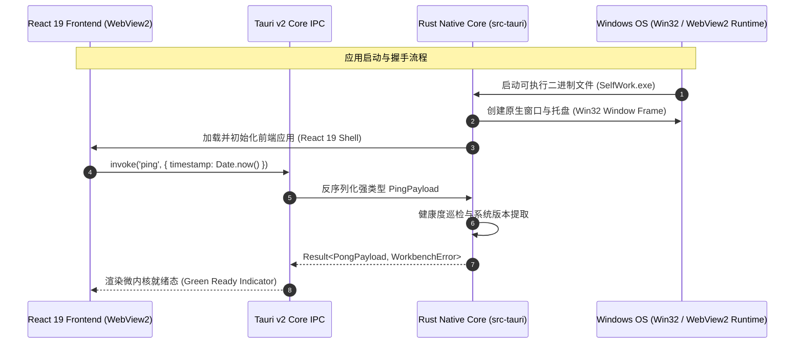

# Technical Design: Desktop Micro-Kernel Host & UI Shell

## 1. System Topology & Process Isolation (Tauri v2)



## 2. Directory Structure & Modular Layout
```text
F:\App Location\SelfWork/
├── src-tauri/                     # 桌面原生核心 (desktop-exe-development)
│   ├── Cargo.toml                 # tauri v2 依赖
│   ├── tauri.conf.json            # 窗口、安全沙箱与构建配置
│   ├── build.rs                   # 构建脚本
│   ├── icons/                     # Windows 应用图标
│   └── src/
│       ├── main.rs                # 原生进程入口
│       └── lib.rs                 # IPC 命令路由 (ping/pong, system info)
├── src/                           # 现代化前端工程 (ui-ux-design-engineering)
│   ├── components/                # 工业级通用组件 (Sidebar, SlotContainer, Header)
│   ├── styles/                    # Design Tokens 与 Tailwind 配置
│   ├── modules/                   # 候选可插拔模块插槽 (类型与占位)
│   │   ├── launcher/
│   │   ├── tasks/
│   │   ├── notes/
│   │   ├── mindmap/
│   │   ├── mcp/
│   │   └── ai/
│   ├── App.tsx                    # 主工作台容器骨架
│   └── main.tsx                   # React 入口
├── package.json                   # 前端依赖配置
├── vite.config.ts                 # Vite 6 构建配置
└── tsconfig.json                  # TypeScript 严格模式配置
```

## 3. UI/UX Design System Specification (Anti-AI-Slop Compliant)
- **8pt 空间网格**：所有边距采用 `space-1` (4px), `space-2` (8px), `space-3` (12px), `space-4` (16px), `space-6` (24px)；
- **排版字阶**：Display 24px (Semi-Bold), Section 16px (Medium), Body 13px (Regular), Caption 11px (Mono/Medium)；
- **调色系统**：
  - Canvas: `#090d16` (深色) / `#f8fafc` (浅色)
  - Surface Elevated: `#111827` (深色) / `#ffffff` (浅色)
  - Border Subtle: `#1f2937` (深色) / `#e2e8f0` (浅色)
  - Brand Accent: `#0284c7` (严谨工程蓝)
- **操作层级**：单视口严格单一主操作按钮，配备完整的 Default / Hover / Focus / Active / Disabled 五态定义。
