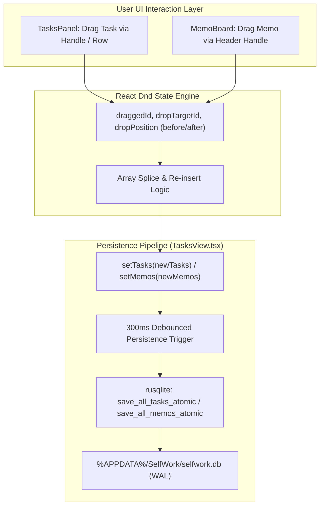
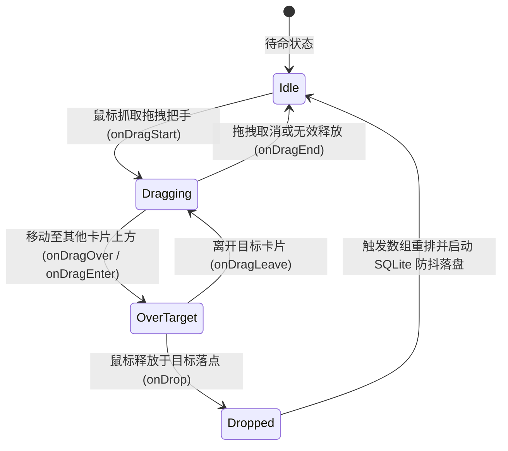

# Design: Tasks & Memos Drag-and-Drop Reordering Architecture

## 1. 拖拽重排因果拓扑与事件流 (Drag & Drop Reordering Pipeline)

## 2. 状态机流转设计 (Drag-and-Drop State Machine)

## 3. 防误触与交互边界隔离 (Anti-Conflict Guardrails)

1. **拖拽把手与可点击控件隔离**:
   - 任务行内加入精致的 `GripVertical` 拖拽把手图标（默认半透明 `opacity-40 group-hover:opacity-100`，`cursor-grab active:cursor-grabbing`）；
   - 勾选复选框、优先级圆点、删除按钮等通过 `draggable={false}` 或独立 `button` 容器阻断冒泡，绝对不触发拖动；
2. **便签卡片编辑隔离**:
   - 便签标题与内容均为 `input` / `textarea`。在文本框区域内获得焦点与文本选区时严禁触发卡片拖动；
   - 拖拽仅在便签卡片顶部操作栏的空白区或专属抓手处触发；
3. **视觉反馈与微交互**:
   - 正在拖动的卡片呈现 `opacity-40 scale-[0.98] border-dashed border-sky-400/50`；
   - 放置目标卡片呈现上下插入指示线或高亮微光，手感清晰自明。
