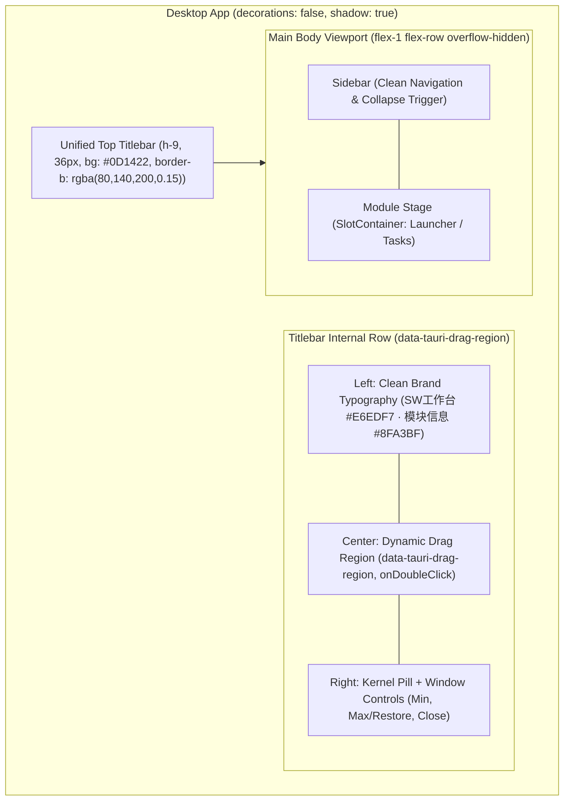
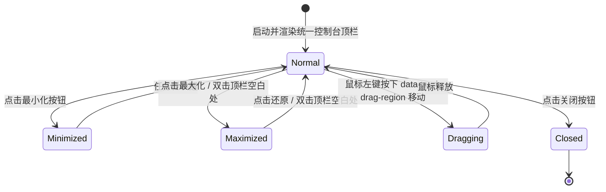

# Design: Unified Dark Console Titlebar Architecture

## 1. 全局视口拓扑结构 (Viewport & Layout Topology)

## 2. 界面层次与色彩体系规范 (Color System & Hierarchy)

| 区域 / 元素 | 变更前视觉缺陷 | 变更后设计标准 | 色彩 / 视觉取值 |
| :--- | :--- | :--- | :--- |
| **顶部栏背景** | Windows 系统默认黑灰或断层浅灰，与页面完全割裂 | 深邃微蓝灰深色，与主视口深色控制台浑然天成 | **`#0D1422`** (沉浸微蓝灰) |
| **左上角区域** | 突兀且强干扰感的 22px 临时占位小图标 | 彻底移除占位小图标，重构纯净品牌文字与模块副标排版 | 主标 **`#E6EDF7`**，副标 **`#8FA3BF`** |
| **底部隔离边界** | 粗暴硬切线或无层次 | 极弱冷调微透描边，有分界但低存在感 | **`rgba(80, 140, 200, 0.15)`** |
| **控件悬浮 (Hover)** | 强反光或粗糙跳色 | 柔和深蓝灰微提亮 | **`rgba(80, 140, 200, 0.12)`** |
| **状态指示 (Active)** | 孤立状态 | 与主页面青蓝色（Cyan/Sky）高亮保持同频 | **`text-sky-400`** / **`bg-emerald-400`** |
| **关闭按钮** | 默认显眼或刺眼大红 | 平时保持暗调克制，悬浮触发柔和微暗红 | **`hover:bg-rose-500/20 hover:text-rose-300`** |

## 3. 硬件级窗口拖拽与状态机流转 (Window Dragging & Physics)

## 4. 技术方案核心要点 (Technical Key Points)

1. **原生零延迟拖拽驱动**:
   - 顶部栏通过 `data-tauri-drag-region` 属性声明，由 WebView2 与 Tauri 底层直接接管 Windows 物理消息循环，彻底去除 JavaScript `handleStartDragging` 的异步微任务与 IPC 延迟，实现 100% 硬件级丝滑拖动与双击最大化。
2. **非拖拽热区隔离 (data-tauri-no-drag)**:
   - 最小化、最大化/还原、关闭三按键以及状态探测胶囊均标记为独立交互按钮，阻止拖拽事件侵吞鼠标点击。
3. **Rust 内核直通命令备用矩阵**:
   - 在 `src-tauri/src/lib.rs` 增设 `window_minimize`, `window_toggle_maximize`, `window_close`, `window_is_maximized` 原生命令，与前端 `@tauri-apps/api/window` 形成双通道高可用容灾。
