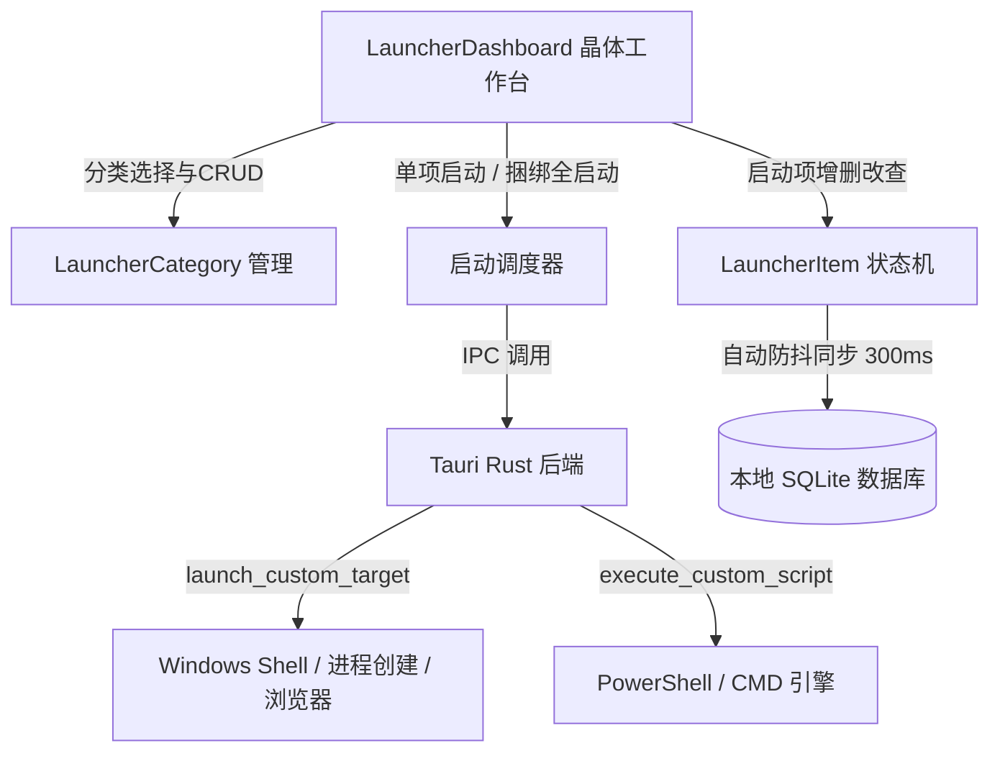

# Design: 通用灵活快速启动工作台技术方案

## 1. 系统架构与分层设计



## 2. 界面拓扑结构与 49px 基准对齐

```
┌──────────────────────────┬────────────────────────────────────────────────────────────┐
│ 左侧分类列表 (w-64)      │ 右侧启动项网格 (flex-1)                                    │
├──────────────────────────┼────────────────────────────────────────────────────────────┤
│ h-[49px] 分类管理 [+分类]│ h-[49px] 当前分类标题 · 项数  [⚡一键全启动] [检索框]      │
├──────────────────────────┼────────────────────────────────────────────────────────────┤
│ 分类项列表 (可滚动)      │ 网格卡片区 (可滚动)                                        │
│ - 全部项目 (8)           │  - [+ 添加启动项] (虚线晶体卡片)                           │
│ - 常用工具 (4)           │  - [应用卡片] (计算器/记事本/自选App)                      │
│ - 常用网页 (2)           │  - [脚本卡片] (构建/拉取/服务脚本)                         │
│ - 运维环境 (2)           │  - [目录卡片] (常用项目目录一键打开)                       │
│                          │  - 操作: 点击唤起 / 悬停编辑 / 悬停删除                    │
└──────────────────────────┴────────────────────────────────────────────────────────────┘
```

## 3. 跨设备通用设计原则
1. **零硬编码路径**：
   - 彻底移除 `D:\应用研究\统一启动器\System\Workflow-Launcher.ps1` 与固定 WSL 探测；
   - 默认预设仅提供 Windows 系统全内置工具（如 `calc.exe` 计算器、`notepad.exe` 记事本、`wt.exe` / `cmd.exe` 终端、GitHub 网页快捷链接等）；
   - 所有后续启动项完全由用户按当前电脑的实际路径自由配置。
2. **安全与静默执行**：
   - 使用 Windows `CREATE_NO_WINDOW` 结合 `std::process::Command`，避免执行后台脚本或打开程序时闪现黑色 CMD 弹框；
   - 支持通过系统默认关联直接唤起（URL 直接调用默认浏览器打开，目录直接用资源管理器打开）。
