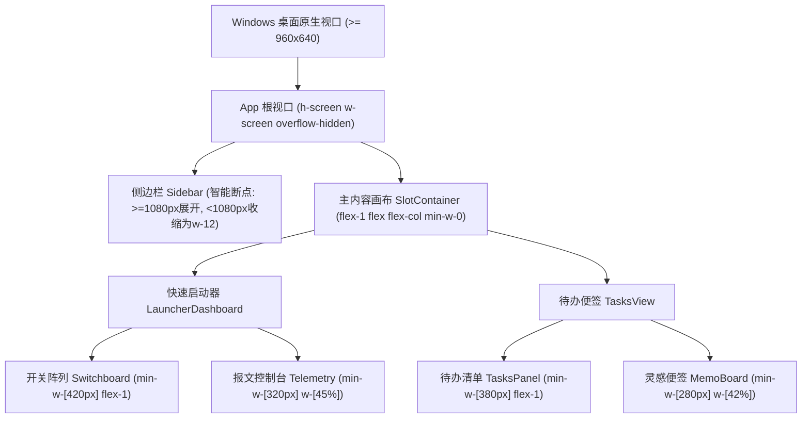

# Design: 窗口与 UI 弹性自适应架构与抗挤压方案

## 1. 架构拓扑与响应式设计

### 1.1 视口与层级伸缩模型

### 1.2 抗挤压不变量系统 (Anti-Squish Architecture)
- **CSS 全局层**：定义 `.anti-squish` 与 `.tactile-btn` 的默认 `shrink-0`，确保任何按钮、胶囊、图标绝无可能在 flex 压缩时变形。
- **微观组件层**：
  - 启动项列表条目采用 `[Icon (shrink-0)] + [Title (min-w-0 flex-1 truncate)] + [Port/PID (shrink-0)]` 布局，保证标题文本自适应伸缩，而外围元数据与图标永不变形；
  - 报文控制台顶部栏拆分为“信息区”与“操作组”，在狭小视口下利用 `overflow-x-auto no-scrollbar` 或弹性流式折行，杜绝重叠挤压。

### 1.3 视口宽度感知器 (Viewport Awareness)
- 在 `App.tsx` 中建立轻量防抖视口监听器：
  - 监控 `window.innerWidth`，在跨越 1080px 临界阈值时自动平滑联动侧边栏 `sidebarCollapsed` 状态；
  - 既保证大屏沉浸办公，又确保小屏/分屏视口下主画板拥有宽阔操作面。
